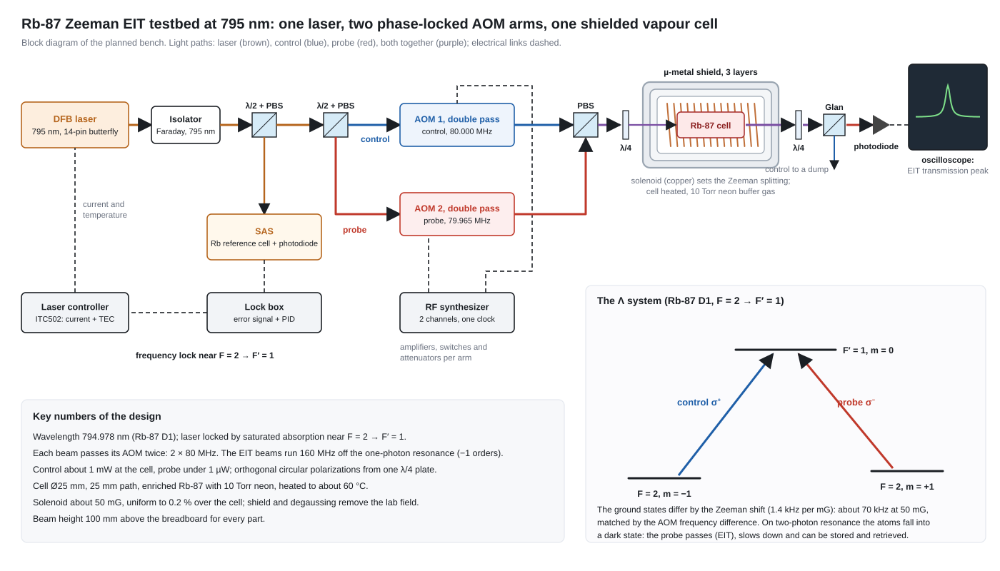

# Rb-87 Zeeman EIT testbed at 795 nm

A room-temperature **electromagnetically induced transparency (EIT)** testbed in a rubidium-87 vapour cell, built as a calibrated atomic reference for slow light, light storage and later tests of new photonic materials.

*One DFB laser is locked to rubidium by saturated absorption. Its light is split into a control and a probe beam, each shifted by its own double-pass AOM driven from one two-channel RF synthesizer. Both beams, in opposite circular polarizations, pass a heated Rb-87 cell inside a solenoid and a three-layer µ-metal shield; a Glan-Taylor polarizer removes the control and a photodiode records the probe. Inset: the Λ system of the Rb-87 D1 line used for Zeeman EIT.*

## How it works, in five steps

1. **Lock the laser.** A small part of the 795 nm DFB beam goes through a reference Rb cell (saturated absorption spectroscopy). A lock box turns the sub-Doppler features into an error signal and steers the laser current through the laser controller, holding the laser near the F = 2 → F′ = 1 line.
2. **Make two beams.** A half-wave plate and a polarizing beamsplitter split the rest into a strong control beam (about 1 mW at the cell) and a weak probe (under 1 µW).
3. **Set the frequency difference.** Each beam passes an 80 MHz AOM twice. The two AOMs are driven from one clock at 80.000 and 79.965 MHz, so the beams differ by exactly 70 kHz: the Zeeman splitting of the two ground states at about 50 mG.
4. **Drive the Λ system.** The beams are recombined and turned into opposite circular polarizations (σ⁺ control, σ⁻ probe) by one quarter-wave plate. In the cell (enriched Rb-87, 10 Torr neon, about 60 °C), the atoms are pumped into a dark state: on two-photon resonance the probe passes almost unabsorbed, with a narrow transparency peak and a large group delay.
5. **Detect and store.** A second quarter-wave plate and a Glan-Taylor polarizer separate the probe from the control before the photodiode. Switching the control off and on with its AOM stores a probe pulse in the atoms and retrieves it later.

## Planned stages

| Stage | What is done | Result |
|---|---|---|
| 1. Platform | build the bench, lock the laser to the Rb-87 line | a laser locked for at least 30 minutes |
| 2. Atomic EIT and storage | CW EIT (contrast, linewidth, slow-light delay), then pulsed light storage and retrieval | the calibrated atomic baseline |
| 3. Material tests at 795 nm | transmission, polarization change and photostability of material samples, reference samples first | measured optical properties |
| 4. EIT compatibility | the EIT measurement repeated with each sample in the probe path | contrast retention and linewidth change per sample |

## Key numbers

| Quantity | Value |
|---|---|
| Wavelength | 794.978 nm (Rb-87 D1, vacuum) |
| Laser | single-frequency DFB, 14-pin butterfly, 5–15 mW needed at the bench |
| Lock | saturated absorption near F = 2 → F′ = 1; EIT beams 160 MHz off the one-photon resonance (−1 orders) |
| AOMs | TeO₂, 80 MHz, double pass, about 1 W RF each |
| Two-photon offset | 70 kHz at about 50 mG (1.4 kHz per mG) |
| Cell | Ø25 mm, 25 mm path, enriched Rb-87 with 10 Torr neon, about 60 °C |
| Field | solenoid about 50 mG, uniform to 0.2 % over the cell, inside a 3-layer µ-metal shield with degaussing |
| Beam height | 100 mm above the breadboard for every part |

## Where to find the details

| Topic | Page |
|---|---|
| The full guide, wiring diagram, bring-up protocol and questions and answers | [Zeeman EIT](https://ruxxzif89.github.io/rb87-eit-lab-guide/index.html) |
| Interactive 3D bench (move parts, trace beams, guided tour) | [3D Bench](https://ruxxzif89.github.io/rb87-eit-lab-guide/bench.html) |
| Every part with quantity, brand suggestion and 3D picture | [Equipment](https://ruxxzif89.github.io/rb87-eit-lab-guide/equipment.html) |
| What the lab already owns | [Lab Inventory](https://ruxxzif89.github.io/rb87-eit-lab-guide/inventory.html) |
| Parts built in the lab (solenoid, cell stack, cables, RF box, printed holders) | [DIY Section](https://ruxxzif89.github.io/rb87-eit-lab-guide/diy.html) |
| Physics background, from photons to quantum memories | [Reading Section](https://ruxxzif89.github.io/rb87-eit-lab-guide/quantum.html) |

The reference design follows Fig. 10 of Finkelstein, Bali, Firstenberg and Novikova, *A practical guide to electromagnetically induced transparency in atomic vapor*, New Journal of Physics 25, 035001 (2023).

The graphic is drawn by `private/figs_overview.py` (not in the public repository); every label is checked for overlaps before the file is written.
