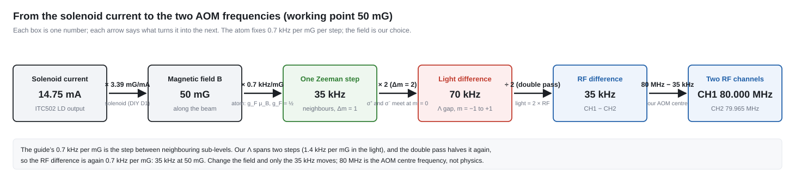
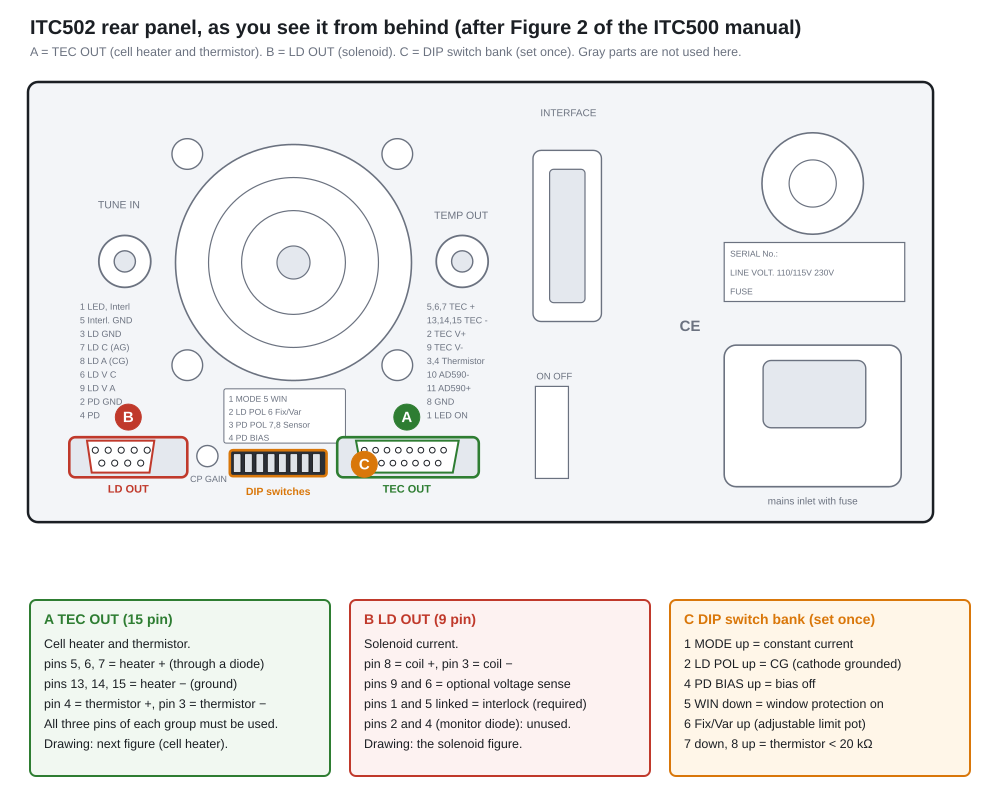
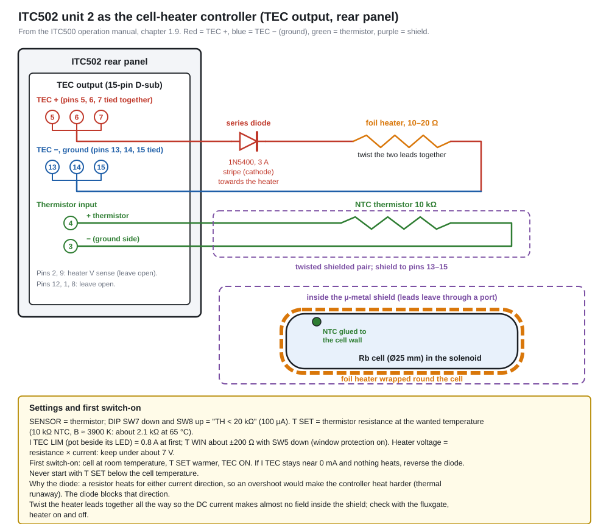
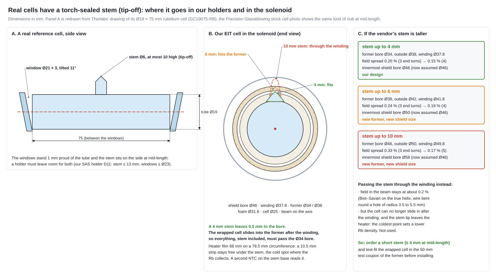
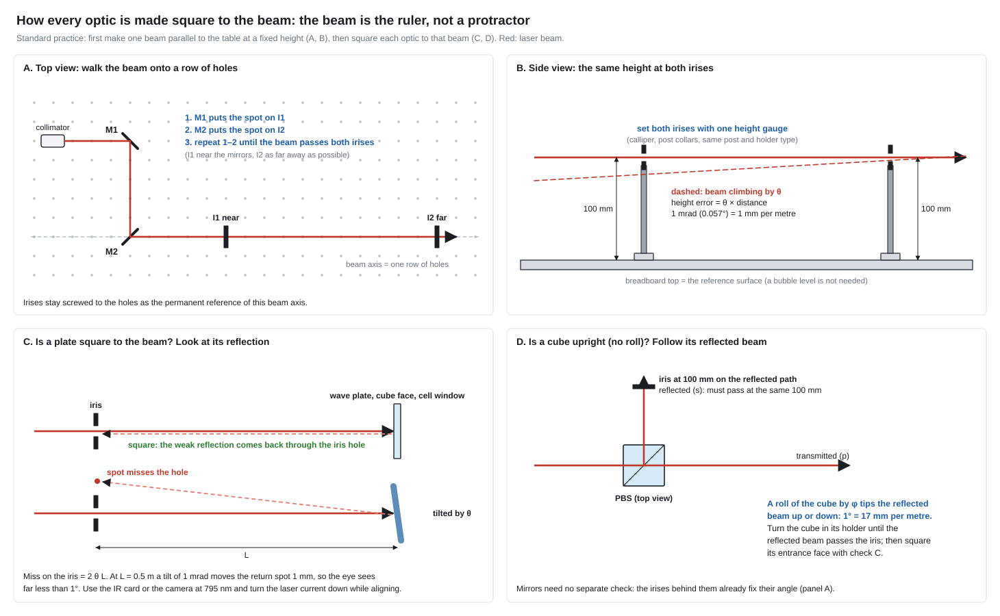
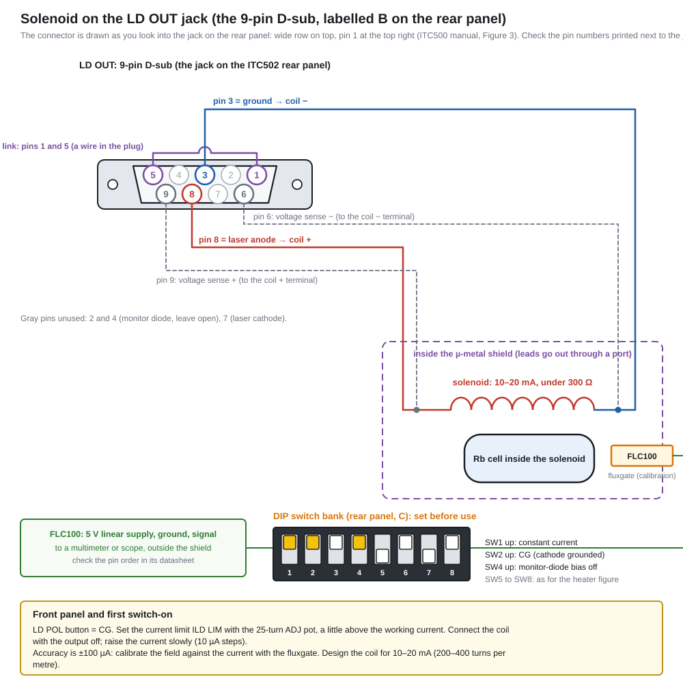

# Questions and answers
Working notes from the project, written 9 Oct 2026. Numbers come from datasheets, the cited papers and this guide's simulator; check them against the vendor documents before ordering or building. No prices on this page. This file is generated from `private/build_qa.py` and mirrors section 09 of the guide.

## The laser and its controller

### Q1. Is our 795 nm DFB laser the right specification, and is 5–15 mW enough?

*Added 10 Oct 2026*

*Equipment shown in the guide: DFB laser module, PM100USB power meter.*

**Update (20 Oct 2026): the Eagleyard BFY12 is no longer in the plan.** The laser is the free-space Yanban RB-795-DFB-BFW with two I795P3D isolators and a PM-fibre link (equipment rows L01, L05, L06). Read this answer as the method and the history; the Yanban numbers are in the entry on the Yanban laser.

**Yes on both counts. It is the manufacturer's Rb D1 spectroscopy part, and its 5–15 mW is the right size: about 1 mW of control light at the cell and under 1 µW of probe need only 5–15 mW at the laser fibre.** The part is the Toptica Eagleyard EYP-DFB-0795-00015-1500-BFY12-0005 (datasheet revision 0.93, 5 Feb 2025). Nothing in the datasheet rules it out, and a 40 mW laser would be wasted.

| Our need | Datasheet | Fit |
|---|---|---|
| Rb-87 D1 line, 794.978 nm | target 794.98 nm reachable at 10–45 °C chip temperature at 15 mW; 0.06 nm/K | yes |
| About 1 mW at the cell | 5–15 mW out of the fibre; 160 mA typical for 15 mW | yes, about 5× margin |
| Linewidth well below about 100 MHz | 0.6 typical, 1.0 MHz at 15 mW | yes |
| Lock range | mode-hop-free over more than 10 GHz; current tuning about 1.4 GHz/mA | yes |
| Single mode | side-mode suppression 30 dB minimum, 45 typical | yes |
| Clean polarization | 20 dB extinction, PM fibre, FC/APC narrow key | yes |
| Protection | built-in micro-isolator (no figure given) plus our free-space isolator (Thorlabs I795P3D) | yes |

**What keeps it from perfect**
- Thin current margin: 15 mW needs 160 mA and the absolute maximum is 170 mA. Set the controller limit to 165–170 mA and run near 10–12 mW for lifetime.
- The ITC502 20 kΩ thermistor range reads up to 19.99 kΩ and this thermistor is about 20 kΩ at 10 °C: keep the chip at 15 °C or warmer, or switch to the 200 kΩ range (coarser, 10 Ω steps).
- Toptica Eagleyard lists the part as about to become obsolete (replacement "on request"): consider a spare.
- The datasheet is a preliminary revision (below 1.0), all figures at beginning of life; the individual test protocol that ships with each laser is what counts.
- The label says Class 4 (20 mW, IEC 60825-1).
- Not stated: isolation of the micro-isolator in dB, the fibre type, how the linewidth was measured.

**How much power we actually need**

| Beam | Intensity in the papers | Power needed at the cell |
|---|---|---|
| Control (1/e² radius 2.55 mm) | 1.3–5.5 mW/cm² | 0.13–0.56 mW if that is the peak intensity, 0.27–1.1 mW if it is power over area (the paper does not say) |
| Probe (radius 0.47 mm) | about 0.12 mW/cm² | under 1 µW |
| SAS lock | the simulator gets 0.09 mW on the photodiode | about 0.2–0.5 mW picked off |

More control power only broadens the line: the EIT width grows by about 4.5 kHz per extra mW/cm². The DeRose experiment ran with about 7 mW out of its fibre.

**Where the light goes** (10 mW laser): free-space isolator ×0.9 (Thorlabs I795P3D, 90 % transmission), 5 % pick-off to the SAS, about 88 % to the control arm, then the double-pass AOM and optics. With realistic AOMs (about 70 % per pass) the control at the cell is about 3.4 mW, so even a 5 mW laser gives about 1.8 mW. The simulator is pessimistic (35 % per pass): 10 mW gives about 0.8 mW and 15 mW about 1.2 mW, still enough.

**So:** minimum about 5 mW, comfortable 10–15 mW, not needed 20–40 mW. Measure the double-pass AOM efficiency (the biggest unknown) and the power at the cell with the power meter; turn the control down with the half-wave plate or the AOM RF level if it exceeds about 1 mW.

**Specification for any 795 nm DFB we buy (for quotes):**

| Item | Requirement | Why |
|---|---|---|
| Type | single-frequency DFB laser diode | narrow, mode-hop free, tuned by current and temperature (no piezo) |
| Wavelength | must reach 794.978 nm (Rb-87 D1, vacuum) at a chip temperature of about 15–35 °C and a current below the maximum | the lock line; outside the TEC/thermistor range it cannot be reached |
| Output power | at least 20 mW from the package (at least 10 mW after a fibre and isolator) | we need 5–15 mW at the bench; margin for AOM and polarization losses |
| Linewidth | ≤ 1 MHz (≤ 2 MHz acceptable) | common to control and probe; the SAS features are 6–12 MHz wide |
| Side-mode suppression | ≥ 30 dB (≥ 40 dB preferred) | single mode on the Rb line |
| Mode-hop-free tuning | ≥ 10 GHz around 794.98 nm | scan across the Rb D1 lines (ground splitting 6.8 GHz) |
| Tuning coefficients | about 0.06 nm/K, 0.003–0.005 nm/mA (state them) | sets the lock-box divider (DIY D6) |
| Operating current / voltage | ≤ 190 mA, ≤ 5 V | ITC502: 0–200 mA, compliance > 6 V |
| Package | 14-pin butterfly, built-in TEC, NTC thermistor, monitor photodiode | ITC502 + butterfly mount (LDM-4980 / LM14S2) |
| TEC | ≤ 1.5 A, ≤ 4 V | ITC502 TEC ±2 A, 16 W |
| Thermistor | 10 kΩ NTC at 25 °C (state B value) | ITC502 20 kΩ range: chip above about 10 °C |
| Pin-out | standard type-1 butterfly (1 TEC+, 2/5 thermistor, 3/4 PD, 10 LD anode, 11 LD cathode, 13 case, 14 TEC−); laser floating from the case | ITC502 wiring (AG or CG) |
| Output (preferred) | PM fibre (PM780, slow axis), FC/APC, about 1 m, built-in isolator ≥ 30 dB | robust pointing, protects the chip |
| Output (accepted) | free-space collimated, about 1 mm beam, with two external isolator stages | the chip must not see the back-reflections |
| Polarization extinction | ≥ 20 dB | clean split at the first PBS |
| Documents | test report of the actual unit: temperature and current at 794.978 nm, P–I curve, spectrum with SMSR, PER; drawing; pin-out | acceptance test on arrival |
| Other | lead time, warranty, laser class, availability of the part (not near obsolescence) | |

**On arrival check:** the test protocol (wavelength against temperature at 15 mW, operating current, extinction ratio), single-mode operation on the spectrum analyser, that the wavelength lands on the Rb D1 line on the SAS signal, and the fibre key alignment.

Sources: [Eagleyard datasheet](https://global-topticaeagleyard.b-cdn.net/wp-content/uploads/data_sheets/EYP-DFB-0795-00015-1500-BFY12-0005.pdf) · [Steck, Rb-87 D line data](https://steck.us/alkalidata/rubidium87numbers.pdf)

### Q2. Is an isolator mandatory, even though most of the bench is free space?

*Added 10 Oct 2026*

*Equipment shown in the guide: DFB laser module, fibre collimator, free-space isolator (I795P3D), double-pass AOM, quarter-wave plate, polarizing beam splitter, Rb vapour cell.*

**Update (20 Oct 2026): the plan now uses the Yanban laser, which has no isolator inside, so two free-space I795P3D isolators stand in series straight behind its window (equipment row L06, quantity 2; about −100 dB at the chip, an estimate). The reasoning below, the feedback budget and the thresholds, still holds.**

**Yes. Free space does not remove the need for an isolator: the returning light comes from the free-space part. Our laser has a micro-isolator inside, and a free-space Faraday isolator right after the collimator (Thorlabs I795P3D, BOM L06) is the second stage. For a laser with no isolator inside, a second stage would be mandatory.**

**Why a DFB laser needs one**
- **It reacts to very little returned light.** In the classic measurements on a DFB laser (Tkach and Chraplyvy, 1986, summarised in [section 2.6 of F. Rogister's thesis](https://arxiv.org/abs/0909.4449)) mode hopping began near −70 dB of returned power, and from −45 dB to −10 dB the line broke up (coherence collapse, 100 MHz to 25 GHz wide). Those figures belong to that laser and are only a guide for ours, but the lesson holds: the line stays as narrow as the data sheet says (about 1 MHz) only if almost nothing comes back.
- **Our own bench sends light back.** Each double-pass AOM arm ends in a cat's-eye mirror that returns the beam exactly along itself. The wave plate and the PBS cube are meant to steer the returning beam out sideways, but no wave plate is perfect: a retardance error of 2° (a plate designed for 780 nm and used at 795 nm is about 1.7° off) or a plate set 1° off its axis lets about 10⁻³ of the returning light (−29 dB) pass the PBS and travel back towards the laser. With the AOM losses and the share of power in the arm, that is about −33 dB at the laser, far inside the coherence-collapse range if nothing blocks it. The 3D simulator uses perfect wave plates, so it shows almost nothing returning and hides this.
- **Flat surfaces add more, and alignment makes it worse.** An uncoated quartz window returns about 3.4 % per surface (−15 dB), a bare silicon detector about a third of the light, an AR-coated optic about 0.25 %. The collimator and single-mode fibre accept only light coming back within about 0.3 mrad (0.02°) of the beam, so a surface has to be square to the beam within about 0.01° to count. That is rare by accident, but it is exactly what happens when a beam is aligned by watching its back-reflection, or when a mirror or card is left square to the beam.

| What protects the laser chip | Returned light at the chip (about −33 dB with nothing in front) | Against the −70 dB and −45 dB marks |
|---|---|---|
| nothing | −33 dB | inside coherence collapse |
| the micro-isolator inside the Eagleyard alone (one stage, typically about 30 dB; its data sheet gives no figure) | about −63 dB | in the mode-hopping band |
| the Thorlabs I795P3D alone (at least 34 dB at 795 nm) | about −67 dB or better | at the edge of the mode-hopping band |
| both, as in our design | about −97 dB or better | far below |

These are estimates (about ±10 dB), not measurements. They show the order of magnitude and why either stage alone is marginal.

**What we do**
- **Put the I795P3D right after the FC/APC collimator.** Thorlabs lists it as a fixed narrowband isolator centred at 795 nm (operating range 775–815 nm), isolation at least 34 dB and transmission 90 % at the centre wavelength, beams up to Ø2.7 mm (our ~1.5 mm beam fits), 0.7 W maximum. Set its input polarizer along the slow axis of the laser fibre, turn it for the highest forward power, and dump both rejected-beam ports.
- **Keep the short gap between the collimator and the isolator clear:** nothing in between. The angled FC/APC fibre end and the AR-coated collimator return very little themselves.
- **Check the replacement of the laser.** The vendor lists the Eagleyard part in our list as about to become obsolete. If its replacement has no isolator inside, the I795P3D alone gives only about −67 dB: then add a second stage (a second isolator in series, or a dual-stage isolator).
- **Habits that cost nothing:** tilt the cell and the detector by a degree or two, dump every unused port, set each double-pass wave plate for the least light in its leak port (not by the scale on the mount), and never leave a mirror or card square to the beam while the laser is on.

**Verdict:** keep both the micro-isolator inside the laser and the free-space I795P3D. One free-space stage is enough while the laser has its own isolator. A feedback fault shows up as a lock that drifts or a line that is wider than the data sheet says, which is slow to trace afterwards, so the isolator goes in before the first alignment.

Sources: [Rogister, Nonlinear dynamics of semiconductor lasers subject to optical feedback (thesis, section 2.6)](https://arxiv.org/abs/0909.4449) · [Eagleyard data sheet EYP-DFB-0795-00015-1500-BFY12-0005](https://global-topticaeagleyard.b-cdn.net/wp-content/uploads/data_sheets/EYP-DFB-0795-00015-1500-BFY12-0005.pdf) (micro-isolator inside, no isolation figure given) · [Thorlabs I795P3D](https://www.thorlabs.com/item/I795P3D) and [Thorlabs NIR free-space isolators (specification table)](https://www.thorlabs.com/nir-free-space-isolators-690---1080-nm)

### Q3. Is the Yanban RB-795-DFB-BFW DFB laser (Alibaba listing) suitable for our bench, and can our ITC502 drive it?

*Added 14 Oct 2026*

*Equipment shown in the guide: DFB laser module (butterfly), free-space isolator (I795P3D), ITC502 controller, butterfly mount.*

**Update (20 Oct 2026): decided. The free-space Yanban is our laser (priced from the offer received), with two isolators and the PM-fibre link; the Eagleyard BFY12 was removed from the equipment list, the 3D bench and the DIY pages.**

**Yes as a laser, on paper, but not in the version listed. The listed RB-795-DFB-BFW is a free-space butterfly with no isolator inside, so we have asked the vendor for a PM-fibre-pigtailed version with a built-in isolator. Until then the Eagleyard BFY12 was kept in the plan (history; see the update above).** The figures below are from the vendor's data sheet (sent to us, not online) and the [Alibaba listing](https://www.alibaba.com/product-detail/795nm-DFB-Laser-Diode_1601867664540.html).

| Our need | RB-795-DFB-BFW data sheet | Fit |
|---|---|---|
| Rb D1 line, 794.978 nm | target 794.97 nm (794–796 nm), 0.06 nm/°C and 0.004 nm/mA; "guaranteed to hit the Rb D1 line" | yes |
| 5–15 mW usable | 100 mW minimum, 120 mW typical | yes, about 10× margin: turn it down with a half-wave plate and a PBS, or run at a lower current |
| Narrow line | 200 kHz typical, 500 kHz maximum (over 100 µs, with a very low-noise driver) | yes, narrower than the BFY12 (about 1 MHz) |
| Single mode | side-mode suppression 40 dB minimum, 45 dB typical; mode-hop free over 20 GHz | yes |
| Polarization | 20 dB extinction | yes, the first PBS cleans it up |
| Laser current on the ITC502 (0–200 mA, compliance above 6 V) | 150 mA typical, 175 mA maximum, 2.0 V | yes: set the current limit at 175 mA or below |
| TEC on the ITC502 (±2 A, 16 W) | 0.4 A, 1.3 V at 120 mW | yes |
| Thermistor on the ITC502 (reads up to 19.99 kΩ) | 10 kΩ at 25 °C, B = 3950 K, so about 20 kΩ at 10 °C | yes: keep the chip above about 11 °C |
| Pin-out | 1 TEC+, 2 and 5 thermistor, 3 and 4 photodiode, 10 and 11 laser anode and cathode, 13 ground, 14 TEC−; the laser floats | looks like the usual 14-pin butterfly layout: check it against the LDM-4980 pin table before connecting |
| **Isolator inside** | **none listed**; the safety notes say "Do not retro-reflect beam! This can cause Catastrophic Optical Damage" | **no** |

**What to watch**
- **Isolation.** With about −33 dB of light returning from the bench (see the isolator answer), one Thorlabs I795P3D (at least 34 dB) leaves about −67 dB at the chip, at the edge of the mode-hopping band, and at 100 mW a strong return can damage the chip. A free-space version would need two stages: two I795P3D in series (about −100 dB) or one Thorlabs IOT-5-780-VLP tandem isolator (55 dB minimum, tunable 760–800 nm, 4.7 mm aperture; about −88 dB). A built-in isolator in a fibre version removes most of this worry.
- **Free-space beam.** About 1.0 × 0.8 mm, divergence 0.1° (about 1.7 mrad; the data sheet does not say whether this is the full or half angle). Over a 1.5 m path the beam grows by about 2.5 mm, so the telescopes we already plan for the arms set the beam sizes. The window centre is about 5.1–5.45 mm above the package base; the mount must leave that end open and be raised to the 100 mm beam height.
- **The 200 kHz needs a very low-noise driver.** With 0.004 nm/mA (about 1.9 GHz/mA) and the ITC502 current noise of 1.5 µA rms, we estimate MHz-level broadening with our controller. That is acceptable: the control and the probe come from the same laser, so most of it cancels in the two-photon detuning, and the SAS lock needs only MHz.
- **Safety.** 100–140 mW is Class 3B (the label also shows a 0.2 W Class IV sticker): goggles rated for 795 nm, rated beam dumps, and the ITC502 interlock.
- **Data-sheet quality.** The mode-hop range is printed in "Pm" (the comment says 20 GHz), and the two wavelength plots do not state their test conditions (about 795.3 nm at 25 °C in one, 794.92 nm at 135 mA in the other). Both suggest the D1 line is reached near 18–25 °C, but only the test report of the actual unit counts.

**What we asked the vendor**
- A PM-fibre-pigtailed version (PM780 fibre, slow axis aligned, FC/APC) with a built-in isolator, its isolation in dB and the power after the fibre and isolator.
- The test report of the actual unit: temperature and current at 794.978 nm, power, side-mode suppression, polarization extinction.
- How the linewidth is measured, whether the divergence is a full or half angle, warranty and lead time.

**What it would change**
- **PM-fibre version with built-in isolator:** it drops into our design in place of the BFY12 (BOM L01). The FC/APC collimator (L05) and the free-space I795P3D (L06) stay as they are, and the two isolators together give about −95 dB or better.
- **Free-space version only:** L01 becomes the RB-795-DFB-BFW, the fibre collimator L05 is dropped, L06 becomes two I795P3D or one IOT-5-780-VLP, and the butterfly mount is checked for a free-space output.
- **Either way** the obsolescence problem of the BFY12 goes away.

**Free space or a PM-fibre version? Both work.** If the data sheet is right, the laser itself meets every need of our bench; the choice is about protection and robustness:

| | Free-space RB-795-DFB-BFW (as listed) | PM-fibre version with a built-in isolator (custom, asked) |
|---|---|---|
| Isolation | none inside: two stages outside (two I795P3D in series, or one IOT-5-780-VLP tandem) | the built-in stage plus our I795P3D after the collimator |
| Beam | about 1.0 × 0.8 mm collimated, straight into the isolator; the fibre collimator (L05) is not needed | round, from our FC/APC collimator (L05); fibre coupling costs part of the 100 mW, still far more than the 5–15 mW we need |
| Pointing | the laser sits on the bench: mount it rigidly on a heat sink, because its pointing drift reaches the SAS and the AOMs (Bragg acceptance about 0.5 mrad) | decoupled by the fibre: the laser can sit off the board, and a replacement does not need realignment |
| Polarization | 20 dB from the chip | 20 dB or what the vendor guarantees after the fibre |
| Mount | butterfly mount that leaves the window end open, raised so the beam is at 100 mm | any 14-pin butterfly mount (fibre exit) |
| Safety | 100 mW open beam right at the package | the beam first appears after the collimator |

**Our view:** if the vendor offers the PM-fibre version with an isolator inside at a similar price and lead time, take it (more robust, less alignment, the internal isolator protects the chip). If only the free-space version is possible, it is manageable: two isolator stages, a rigid heat-sinked mount, and the same alignment as any free-space diode laser.

**Is a free-space DFB normal in published work? Yes: it is how our reference design does it.** In the guide we follow (Finkelstein, Bali, Firstenberg and Novikova, New J. Phys. 25, 035001 (2023), Sec. V.1 and Fig. 10), the laser is a free-space diode laser (an ECDL in their figure; they state that DFB lasers with 1–2 MHz linewidth also satisfy all the requirements and are widely used in EIT experiments). Its beam goes through a free-space optical isolator and is then coupled by the experimenters into a polarization-maintaining fibre, only to clean the beam profile and polarization; the fibre output is then split at a PBS. A free-space Yanban can follow exactly this route: isolator stages straight after the package, then (optionally) a FiberPort coupler into a PM patch cord, and from there the bench is the same as with a pigtailed laser. The lab already owns FiberPort couplers (PAF2-5B, PAF-X-18-B in the Lab Inventory). Another example: Mottola, Buser and Treutlein (arXiv:2307.08545) use a commercial 795 nm DFB as the D1 probe in a Rb vapour experiment.

**Since we cannot fully check the data sheet:** ask for the test report of the actual unit, and test it on arrival before anything else: threshold and power against current (power meter), the four Rb D1 absorption dips and the saturated-absorption features in the reference cell while scanning the current (this proves it reaches the line and stays single-mode across the scan), and the polarization extinction with a polarizer. A laser that shows the SAS features cleanly at a chip temperature inside the 20 kΩ thermistor range is fit for our bench.

**Can our Thorlabs ITC502 drive it? Yes.** Every figure of the laser is inside the ITC502 ranges (ITC500 operation manual, technical data 1.5.1):

| The laser needs | ITC502 gives | Fit |
|---|---|---|
| 150 mA typical, 175 mA maximum | 0 to ±200 mA; hardware limit ILD LIM 0 to ≥ 200 mA | yes: set ILD LIM at about 170 mA before the first switch-on |
| 2.0 V | compliance above 6 V | yes |
| Monitor photodiode 5 µA/mW (about 0.5 mA at 100 mW) | monitor current range 5 µA to 2 mA | yes (only needed for constant-power mode; the lock uses constant current) |
| TEC 0.4 A, 1.3 V at 120 mW | ±2 A, 16 W, compliance above 8 V | yes: start with I TEC LIM at about 0.5 A, because the data sheet gives no TEC maximum |
| NTC 10 kΩ at 25 °C, B = 3950 K | thermistor ranges 10 Ω–19.99 kΩ (100 µA) and 100 Ω–199.9 kΩ (10 µA) | yes: the 20 kΩ range works down to about 10 °C (20.2 kΩ); the D1 line is expected near 18–25 °C |
| Current tuning for the lock (0.004 nm/mA, about 1.9 GHz/mA) | modulation input 20 mA/V, DC to 500 kHz | yes; see the divider note below |

**Wiring** (ITC502 9-pin laser jack from the manual, section 1.9.1; the laser floats, so either polarity works):
- **Polarity CG:** ITC pin 8 → laser anode (butterfly pin 10), ITC pin 3 → laser cathode (pin 11); voltage sense pin 9 to pin 10 and pin 6 to pin 11. (With AG instead: pin 7 → cathode, pin 3 → anode.)
- **Monitor diode:** ITC pin 4 (input) and pin 2 (ground) to butterfly pins 3 and 4, in the polarity the manual's monitor-diode section asks for.
- **Interlock:** pins 1 and 5. **TEC jack (15-pin):** TEC+ (pins 5, 6, 7) → butterfly pin 1, TEC− (pins 13, 14, 15) → pin 14, thermistor (pins 3, 4) → pins 2 and 5. Case ground (pin 13) to the shield and ITC ground.
- In practice the butterfly sits in a mount (the lab's ILX LDM-4980 or a Thorlabs LM14S2), and the cables go to the mount: check the mount's pin table against these before switching on, and run the dummy-load test of DIY part D3 first.

**Lock-box divider (DIY part D6).** The divider was sized for the BFY12 (about 1.4 GHz/mA): 91 kΩ over 1 kΩ gives about 0.28 GHz per volt and a 0.55 GHz swing. With this laser (about 1.9 GHz/mA) the same 91 kΩ gives a 0.75 GHz swing, which still works; about 120 kΩ restores the same scale.

**The 200 kHz line** needs a very low-noise driver: the ITC502 current noise (1.5 µA rms, 10 Hz–10 MHz) times 1.9 GHz/mA is about 3 MHz of frequency noise, so expect a MHz-level line with our controller. That is acceptable for Zeeman EIT (common to control and probe) and for the SAS lock.

Sources: RB-795-DFB-BFW data sheet (Yanban Laser, from the vendor) · [Alibaba listing](https://www.alibaba.com/product-detail/795nm-DFB-Laser-Diode_1601867664540.html) · [Thorlabs NIR free-space isolators (I795P3D, IOT-5-780-VLP)](https://www.thorlabs.com/nir-free-space-isolators-690---1080-nm) · Thorlabs ITC500 operation manual (ITC502 technical data and laser-jack pin assignment)

### Q4. How do we make the free-space Yanban beam equal to a PM-fibre-pigtailed laser (profile, polarization, pointing)?

*Added 19 Oct 2026*

*Equipment shown in the guide: butterfly laser mount, free-space isolator, half-wave plate, steering mirror, FiberPort coupler.*

**Couple it into a polarization-maintaining single-mode fibre ourselves.** A PM-pigtailed laser is the same chip with an isolator, a lens and a PM fibre built into the package. The fibre is what makes its output a clean round Gaussian with a fixed polarization axis and a fixed pointing, so the only way to get exactly that output from a free-space laser is to put the same fibre in the path. This is also what our reference design does: Finkelstein et al. (New J. Phys. 25, 035001 (2023), Sec. V.1 and Fig. 10) send their free-space laser through an isolator and then into a PM fibre, to clean the beam profile and the polarization. Free-space optics alone (lenses, prisms, a pinhole) only come close.

**Our setup: through the PM fibre (decided 19 Oct 2026).** The equipment list (Yanban option) now has the fibre link (row L05) to buy; its two steering mirrors and mounts are counted in the mirror rows O01 and O02 (11 in all: the 3D bench draws the whole link, and with the fibre no separate master-axis mirror pair is needed after the output FiberPort). The 3D bench (3D Bench tab) now shows the link: two isolators, steering mirrors, half-wave plate, FiberPort coupler, the yellow PM fibre and the output FiberPort. **Was the fibre strictly needed? No.** The free-space beam could go straight from the two isolators into the bench (half-wave plate, PBS, AOM arms). The laser already gives a single-frequency, nearly round 1.0 × 0.8 mm beam (a good size for the AOMs) with 20 dB polarization, and the first PBS cleans the polarization. What the direct beam does not give:
- **Pointing decoupling:** drift of the laser mount or the isolators (temperature, screws settling) moves the beam on the AOMs (Bragg acceptance about 0.5 mrad), the SAS and the cell; a laser swap means realigning the bench. With the fibre, such drift changes only the coupled power.
- **A guaranteed clean mode:** the data sheet gives no beam-quality figure (M²); the fibre passes only its own Gaussian mode.
We chose the fibre for exactly these reasons: a guaranteed clean Ø1 mm beam at the AOMs (the direct beam would need a reducing telescope), and a bench that stays aligned whatever happens on the laser side.

**Direct or through the fibre: which is better?**

| | Direct into the bench | Through the PM fibre |
|---|---|---|
| Parts after the isolators | none extra | half-wave plate, 2 steering mirrors, coupler, patch cable, output collimator |
| Alignment work | the laser-to-bench alignment once | the same plus fibre coupling and the polarization launch (a few hours, a practised skill) |
| Power at the bench | about 80 mW (two isolators at 90 %) | tens of mW (coupling losses), still far more than the 5–15 mW needed |
| Beam profile | whatever the chip gives (no M² on the data sheet) | a clean round Gaussian, guaranteed by the fibre |
| Beam 1 m after the source (at the AOMs) | Ø2.3 mm if the data-sheet 0.1° is the full angle, Ø4.4 mm if it is the half angle: larger than the 2 mm AOM aperture, so a lens or a reducing telescope is needed before the AOMs (the data sheet implies M² ≈ 1.7 or 3.4) | Ø1.5 mm from a Ø1 mm FiberPort output (1.087 mrad) |
| Polarization | 20 dB from the chip, cleaned by the first PBS | set by the fibre axis; can wander a little with temperature if the launch is off |
| Pointing on the AOMs, SAS, cell | follows any drift of the laser mount and isolators | fixed by the output collimator; laser-side drift only changes the power |
| Laser swap or repair | realign the bench | realign only the coupling |
| Extra maintenance | none | an occasional touch-up of the coupler |

**See both in 3D:** [the laser-source simulation](laser-source-3d.html) shows the two layouts at the 100 mm beam height with the alignment steps, the data-sheet values, and the power, isolation and beam-size budgets.

For EIT itself the two give the same result: the experiment needs a stable single-frequency beam of a few mW in a known polarization, and the PBS and the cell do not care about a slightly non-ideal profile. The fibre buys long-term stability and an ideal beam at the price of one more alignment stage. We chose the fibre (19 Oct 2026); the direct beam remains the fallback if the fibre coupling ever becomes a problem.

**The sequence, from the chip to the bench**

| # | Part | Why there | Our part |
|---|---|---|---|
| 1 | Butterfly laser in a metal, heat-sinked mount, driven by the ITC502 | the chip's TEC pumps its heat into the mount; current limit 170 mA | lab ILX LDM-4980 (check its pin table first) |
| 2 | No extra lens | the data sheet gives a collimated beam of about 1.0 × 0.8 mm (check it on arrival: same size at 0.2 m and 2 m) | none |
| 3 | Isolator, stage 1, right at the laser window | no isolator inside the laser; nothing reflective may come before it | Thorlabs I795P3D (≥ 34 dB) |
| 4 | Isolator, stage 2 | one stage leaves about −67 dB at the chip; two give about −100 dB | a second I795P3D, or one IOT-5-780-VLP tandem (55 dB) |
| 5 | Two steering mirrors | the two degrees of freedom of beam walking into the coupler. They come BEFORE the half-wave plate: a silver mirror at 45° keeps a linear polarization unchanged only if it is horizontal or vertical (s or p); the isolator output is at 45°, and the mirrors must not see any other angle | mirrors in kinematic mounts (row O01/O02) |
| 6 | Half-wave plate, right before the coupler | turns the polarization onto the slow axis of the fibre; with the mirrors already behind it, nothing between the plate and the fibre can change it | ؽ″ zero-order HWP in a rotation mount |
| 7 | Fibre coupler (input) | focuses the beam onto the fibre core; its tip, tilt and focus are adjustable | lab Thorlabs PAF2-5B FiberPort (f 4.6 mm, made for a Ø1 mm beam with a 5 µm mode, so it matches our 1.0 × 0.8 mm beam) |
| 8 | PM single-mode fibre | the mode and polarization filter: everything after it behaves like a pigtail | PM780 patch cable, FC/APC both ends (for example Thorlabs P5-780PM-FC-2) |
| 9 | Output collimator | the bench beam starts here, at 100 mm, exactly as with a pigtailed laser | a second FiberPort (about Ø1 mm beam, good for the AOMs) or the planned FC/APC collimator |

After step 9 the bench is the one already designed (wave plate, PBS, AOM arms, cell); the isolation now sits before the fibre, so returns from the bench travel back through the fibre and are stopped by stages 1 and 2.

**Alignment, in order**
1. **Laser on, low power:** set the ITC502 current limit and the TEC first; check that the laser reaches the Rb line (absorption and saturated-absorption features in the reference cell while scanning the current).
2. **Isolators:** turn each isolator about the beam until the transmitted power is maximum (its input polarizer is then along the laser polarization); keep the beam centred in the aperture.
3. **Order of mirrors and wave plate:** the two isolator-side mirrors see the 45° output of the isolator, so first turn the second isolator (or the beam path) so that the beam is horizontal or vertical at the mirrors if the plate is to come after them; the half-wave plate sits just before the coupler and is set in step 5.
4. **Fibre coupling:** with both mirrors, walk the beam into the coupler while reading the power at the fibre output with the power meter (first mirror for position, second for angle, alternately), then optimise the focus of the coupler, and repeat. Expect a good part of the power to be coupled when the modes match; measure it rather than assume it.
5. **Polarization:** put a polarizer and the power meter after the output collimator. Turn the half-wave plate for the deepest minimum (the input is then on a fibre axis). Then warm or gently bend the fibre: if the output power through the polarizer changes, the input is not on the axis yet; turn the plate until warming and bending change nothing. That is the standard way to launch into a PM fibre.
6. **Lock it down:** tighten the locking screws of the mounts and the coupler, write down the coupled power, and check it again the next day.

**Power:** 100 mW from the laser, about 90 % through each isolator stage, then the fibre coupling: tens of milliwatts at the output, still far more than the 5–15 mW we need. Run the laser at a lower current or turn the power down after the fibre.

**The fixed mount: metal, not PETG.**
- **Heat:** the butterfly's TEC pushes the chip's heat into its base; a PETG base insulates (several times worse than aluminium), so the TEC cannot hold the temperature, and PETG softens not far above 60 °C.
- **Stability:** coupling into a 5 µm fibre core needs micrometre stability. PETG creeps under screw load and expands several times more than aluminium with temperature, so the coupling would drift.
- **What works:** a flat aluminium base plate (a casting is fine if its mounting faces are machined flat), the laser mount and the optics on short, low posts, locking screws on every mount, and a cover against air currents. PETG is fine for that cover.
- **What the fibre does for stability:** it does not remove all alignment (the free-space coupling can drift slowly and need a touch-up of the coupler), but it fixes everything after it: a touch-up changes only the coupled power, never the beam position on the bench.

Sources: Finkelstein et al., New J. Phys. 25, 035001 (2023), Sec. V.1, Fig. 10 · Yanban RB-795-DFB-BFW data sheet (from the vendor) · Thorlabs PAF2-5B FiberPort and I795P3D specifications · [Thorlabs PM780-HP fibre (MFD 5.3 µm at 850 nm)](https://www.thorlabs.com/catalogpages/obsolete/2019/PM14XX-HP.pdf)

### Q5. DFB or ECDL? Why not an ECDL, why do the reference papers use one, and is a narrow linewidth crucial?

*Added 10 Oct 2026*

*Equipment shown in the guide: DFB laser module, Rb vapour cell.*

**A DFB is good enough for this experiment and much cheaper and simpler. An ECDL would be a luxury, not a requirement.** The reason is that the laser's own linewidth is not what sets the EIT line.

**Two linewidths that get mixed up**
- **The EIT linewidth** is the narrow one (7.3 kHz at 1.3 mW/cm², 26 kHz at 5.5 mW/cm²). It is set by control intensity, magnetic field, buffer-gas diffusion and coherence time, not by the laser.
- **The laser linewidth** only has to be well below the optical width of the atoms (Doppler about 500 MHz, wider with buffer gas). Our 0.6–1 MHz is 100× below.

**What matters more** (my reasoning)
- **Relative phase of control and probe.** Both come from the same laser through phase-locked RF, so the laser's phase noise is common to both and cancels. A 1 m path difference (about 3 ns) at 1 MHz linewidth gives a relative phase variance of only about 0.02 rad² (0.14 rad rms), so about 98 % of the two-photon drive stays narrow (calculator 4 of the [distance calculator](optics-calc.html)). What reaches the atoms is noise from the RF source and drift in the arm lengths.
- **Lock stability.** The laser must stay within a fraction of the optical width; the DeRose paper reports drift of about 10 MHz per hour and negligible drift during data taking.

**DFB against ECDL**

| | DFB (our choice) | ECDL |
|---|---|---|
| Linewidth | 0.6–1 MHz | a few hundred kHz |
| Tuning | mode-hop-free over more than 10 GHz by current and temperature | wide, but piezo and grating alignment |
| Build | one sealed, fibre-pigtailed butterfly with isolator | open cavity, more sensitive to vibration, mode hops |
| Lock actuator | laser current (fast and simple) | piezo plus current feed-forward |
| Cost | the lower one | typically several times more |

**Why a DFB is enough**
- The papers only ask for a linewidth far below the Doppler width (about 500 MHz), and 1 MHz passes easily.
- The 10 Torr Ne buffer gas makes the optical line wider still (order 100 MHz).
- The narrow 7–26 kHz EIT line depends on the control–probe phase relation, not on the laser's own linewidth; both beams share the laser's noise (my reasoning, not quoted from a paper).
- We need only about 1 mW at the cell.
- A narrower laser helps only with a very noisy driver or sub-Doppler spectroscopy at the few-MHz level; the SAS features are 6–12 MHz wide (the D1 natural width is 5.75 MHz), which a 1–2 MHz laser resolves.

**Why the reference papers use ECDLs.** No sentence in either paper says why, so this is partly inference. What they do say: ECDLs have a linewidth of a few hundred kHz, DFBs about 1–2 MHz, and either is fine for EIT. Likely reasons (my judgment):
- **Installed base:** atomic-physics labs have used ECDLs for decades and these groups already own several.
- **Reuse:** an ECDL covers other wavelengths and atoms and scans over several GHz.
- **Narrower line:** more margin for sub-Doppler spectroscopy, not needed for EIT.
- **Wavelength availability:** DFB diodes exactly on the Rb D1 line used to be less common.
- **Teaching setup:** the DeRose paper is an undergraduate set-up where students scan the laser by hand.

None applies strongly to us: one fixed target line, no existing ECDL, and a budget. For a real answer, ask the authors.

**When an ECDL would be better:** driver current noise turning into linewidth (1 µA is about 1.4 MHz), scanning several GHz or other lines, a replacement if the DFB is no longer available, or an ECDL already in the building.

### Q6. What specification do the AOMs and their RF driver need (for a quote)?

*Added 14 Oct 2026*

*Equipment shown in the guide: AOM (double pass), two-channel RF source, RF amplifier, RF attenuator, RF switch, directional coupler.*

**Two identical 80 MHz TeO₂ AOMs for 795 nm (one per arm, each in double pass), driven by one two-channel RF source with a common clock, an amplifier, an attenuator and a fast switch per channel. Two are enough: the 160 MHz lock offset is handled without a third AOM (see the end).** Our planned parts are BOM O17 (Gooch & Housego 3080-125) and R01–R06; the table is what any alternative must meet.

**AOM (2 pieces)**

| Item | Requirement | Why |
|---|---|---|
| Wavelength | 795 nm, AR coated (≤ 0.5 % per surface) | Rb D1 line; each surface reflection is lost light and feedback |
| Material, frequency | TeO₂ longitudinal mode, 80 MHz centre, bandwidth ±10 MHz or more | we tune only about ±1 MHz around 80 MHz |
| Aperture | ≥ 1.5 mm (2 mm preferred) | our beam is 1.0–1.5 mm |
| Diffraction efficiency | ≥ 80 % single pass at 795 nm (ask for the figure at our beam size) | double pass squares it: 80 % gives 64 % |
| Rise time | ≤ 200 ns for a 1 mm beam | about 0.64 × D / v = 150 ns per mm in TeO₂ (v ≈ 4.2 mm/µs); storage pulses are microseconds |
| RF power | ask the figure at 795 nm; expect about 1.5–2 W; maximum input ≥ 2 W | the power for full efficiency grows as λ²: 1 W at 633 nm becomes about 1.6 W at 795 nm |
| Extinction (on/off) | ≥ 1000:1 | the control light must be off during storage |
| Separation angle | about 15 mrad (0.87°) at 80 MHz | λ·f/v; sets the cat's-eye and iris geometry |
| RF input | 50 Ω, SMA, VSWR ≤ 1.5:1; ask whether DC is blocked | matches the amplifiers; DC on the line is an open item |
| Mechanics | flat base, tapped holes, drawing; conduction cooling | mounted on the DIY D9 platform at 100 mm beam height |

**RF driver (2 phase-locked channels)**

| Item | Requirement | Why |
|---|---|---|
| Channels | 2 from one reference clock (10 MHz in/out) | the control–probe difference (35 kHz in RF, 70 kHz in light) must not drift; separate fixed drivers cannot do this |
| Frequency | 70–90 MHz, resolution ≤ 1 Hz | working points 80.000 and 79.965 MHz; the EIT line is a few to tens of kHz wide |
| Power | 0 to +33 dBm (2 W) per channel into 50 Ω, ≥ 30 dB adjustment | sets each arm's power without touching the optics |
| Gating | TTL per channel, rise/fall ≤ 50 ns, on/off isolation ≥ 60 dB | slices the probe pulse and turns the control off for storage |
| Amplitude modulation | optional analog input, ≥ 1 MHz | pulse shaping for better storage efficiency |
| Purity, protection | spurs ≤ −50 dBc, harmonics ≤ −20 dBc; survives an open or shorted output | clean sidebands; an unplugged AOM must not kill the amplifier |

Our planned build meets this from separate parts: Windfreak SynthHD (two channels, one clock), two Mini-Circuits ZHL-1-2W-S+ amplifiers (+33 dBm), ZX76-31R5-PN-S+ attenuators, ZASWA-2-50DR+ switches and ZFDC-20-4-S+ couplers. An integrated driver from an AOM maker is fine only if both channels share one clock.

**The 160 MHz lock offset without a third AOM.** Both EIT arms are shifted by 160 MHz (double pass at 80 MHz) and the SAS light is not, and no SAS feature of the F = 2 line lies 160 MHz from F = 2 → F′ = 1 (the nearest, the F′ = 1/F′ = 2 crossover, is 407 MHz away). Two free solutions:
- **Lock on F = 2 → F′ = 1 and run the EIT beams 160 MHz off the one-photon resonance (recommended).** EIT in Zeeman Λ depends on the two-photon detuning (the kHz difference of the two AOMs), not on the one-photon detuning, and in a warm cell the Doppler profile is wide: about 530 MHz FWHM at 60 °C (σ ≈ 225 MHz). At 160 MHz off the line centre the absorption is about 78 % of the peak, so the cell needs about 3 °C more for the same optical depth (the Rb density rises about 8 % per °C near 60 °C). Use the −1 order in both AOMs (−160 MHz): F′ = 2 is then 974 MHz away instead of 654 MHz, so its contribution becomes negligible. Expect a slightly asymmetric EIT line at this detuning in a buffer-gas cell; contrast and width are still measured the same way.
- **Take the SAS light from the control arm after its AOM** (a small pick-off after the double pass), so the lock sees the shifted light and the control sits exactly on the line. The catch: when the control is switched off for storage, the lock light disappears too, so the lock box must hold its output during the off time (microseconds, much shorter than the lock response).
A third AOM in the SAS arm would also work, but it is not needed and is not in the budget.

**Update (20 Oct 2026): AOM yes, driver no.** The supplier offers the AOM (795 nm, 80 MHz, 2 mm aperture, SMA input, maximum RF power 2 W, diffraction efficiency above 85 %) but cannot make our two-channel driver (the 1 Hz frequency steps). So we buy the two AOMs only and drive them with route A below, the chain already in the equipment list (R01–R06: SynthHD, switch, attenuator, amplifier, coupler) plus the DIY D8 bias box. The SMA input connects straight to that chain. The 2 W limit sets one rule: keep the synthesizer at +1 dBm (about 1 W at the AOM) and never above +2 dBm. (21 Oct 2026: the AOM now chosen, the FAOM-780-80-2, is rated 2 W, so the rule stands; see the FAOM answer.) Still to get in writing: the RF power at which the 85 % was measured (and with which beam size and polarization), the AR coating at 795 nm, the rise time for a 1 mm beam, and a drawing.

**Is route A "building the driver ourselves"? Mostly not.** Nothing is designed or soldered in the RF path: every block is a finished, boxed module with SMA connectors (the SynthHD synthesizer and the Mini-Circuits switch, attenuator, amplifier and coupler), joined with SMA cables. This is how many atomic-physics labs drive their AOMs. The only home-made part is the small bias box (DIY D8) that gives the switches and attenuators their supply voltages and control lines, and it can shrink further: the SynthHD sets its own output level in software, so the step attenuators can be left out, and the switches need only +5 V and −5 V from a bench supply plus a TTL gate. The work is then cabling, the synthesizer software, and the commissioning order of D8 (load the amplifier before switching it on, heat sink, synthesizer never above +2 dBm). A ready-made multi-channel DDS AOM driver from a specialist maker would avoid even that, at a higher price.

**Status and decision path (16 Oct 2026).** An AOM supplier can make the AOM to this specification; the RF driver is the open item. Before confirming the AOM, get in writing: RF connector (SMB or SMA), maximum RF input power, diffraction efficiency at 795 nm and the RF power for it, AR coating covering 795 nm, input polarization, and a drawing. For the driver, three routes are compared:
- **A, our planned build from parts:** two-channel synthesizer (SynthHD), per channel an RF switch, a step attenuator, a 2 W amplifier and a monitor coupler, plus the DIY D8 bias box.
- **B, a two-channel box from the AOM supplier** built to our block diagram (two tunable channels from one clock, fast TTL gates, analog amplitude inputs, monitor ports, about 1 W per channel, 2 W maximum, a frequency sweep on the probe channel).
- **C, a budget fallback:** a four-channel DDS board based on the Analog Devices AD9959 (all channels from one clock, sub-hertz steps) in place of the synthesizer, with the same RF parts, a low-pass filter per channel, and our own control software.
B is taken if it meets the specification and costs less than A; C only if the budget forces it. Whatever the route, a fixed-frequency driver (its own oscillator per channel) is never accepted: the 35 kHz difference must come from one clock and stay tunable.

**Can route A be simplified: no step attenuators, switches powered from the bench supply? (answer of 20 Oct 2026)** Possible, and a smaller build, but not proven on this bench, and the guide has no step-by-step version of it yet (DIY D8 describes the full chain with attenuators). What the data sheets and the parts say:
- **What the attenuators (R03) do.** They set each arm's RF level in 0.5 dB steps and, with the DIP switches at 31.5 dB, give a safe state at power-up. The SynthHD can set its own level in software (public listings give roughly −40 to +20 dBm; the exact range at 80 MHz must be read from the data sheet of our unit), so the steps are not needed for tuning.
- **What replaces the safe state.** (1) The RF switch (R04) keeps its gate input pulled low, so the AOM gets no RF until the gate goes high. (2) Set the synthesizer level before enabling its output, and keep it at +1 dBm with the attenuator in the chain (never above +2 dBm for the 2 W FAOM; without the attenuators +1 dBm already gives about +31 dBm). (3) The amplifier takes at most +10 dBm at its input, so a fixed SMA attenuator of 6 dB in front of it, an inexpensive part, caps the worst case if the synthesizer ever powers up at a high stored level. This pad is my suggestion, not a Mini-Circuits requirement.
- **Switch supply.** The ZASWA-2-50DR+ needs +5 V and −5 V and a TTL gate (D8 records the pin numbers from its data sheet). A bench supply with two floating outputs can give ±5 V by joining the minus of one channel to the plus of the other as the common; check in the supply's manual that its channels float, and tie the common to the RF ground at one point only. The separate +24 V for the amplifiers stays.
- **What it removes.** Two ZX76 attenuators with their DIP banks, pull-downs and 10-pin cables, and the LM317/LM337 cells for ±3 V in the bias box; the ±5 V cells can go too if the bench supply gives them.
- **What it does not remove.** The DC-block requirement on the RF lines, the commissioning order of D8 (bias, +24 V, synthesizer; the amplifier into a 50 Ω load first, the AOM last), and the open question of the SynthHD harmonics at 80 MHz.
So: reasonable to adopt after a bench test with a 50 Ω load and an oscilloscope, following the commissioning order of D8 without the attenuator steps. It is not yet written up as a DIY part.

**Reading an AOM data sheet or listing: check these, in this order.**
1. **Wavelength and AR coating.** It must cover 795 nm (for example 780–850 nm, or 700–1100 nm). A 633 nm, 532 nm or 1064 nm part is the wrong coating.
2. **Centre frequency.** 80 MHz is what our RF chain and frequencies are built around. A 110 MHz part also works, but then both AOMs must be 110 MHz and the beams sit 220 MHz off the line instead of 160 MHz.
3. **Material and mode.** TeO₂ **longitudinal** mode. Avoid **shear-mode** TeO₂ (slow acoustic wave, about 0.6 mm/µs, so switching is several times slower and the angles are large) and quartz or fused-silica parts (much more RF power).
4. **Active aperture.** At least 1.5 mm; a 1 mm aperture clips our beam.
5. **Diffraction efficiency at our wavelength.** At least 80 %. Many listings quote it at 633 or 1064 nm only: ask for the figure near 795 nm.
6. **RF power for that efficiency.** It must be reachable with our amplifiers (up to about 2 W): about 1–2 W at 795 nm is right; a part that needs 3–4 W is not.
7. **Rise time.** Usually given per mm of beam: about 150 ns per mm (TeO₂ longitudinal). Under 200 ns for a 1 mm beam.
8. **RF input.** 50 Ω, SMA, VSWR at most 1.5:1, maximum RF power at least 2 W.
9. **Size and mounting.** A drawing with the housing, the hole pattern and the height of the aperture above the base.
10. **The driver.** Buy the AOM alone, or with a driver that accepts an external RF input. A fixed-frequency driver (its own oscillator) cannot be phase-locked to the other arm, so it is no use for the control and the probe.

**The earlier planned part (superseded on 21 Oct 2026 by the FAOM-780-80-2), the Gooch & Housego AOMO 3080-125, against this list** (G&H outline drawing 97-01598-01, rev D):

| Check | 3080-125 drawing | Verdict |
|---|---|---|
| Material, mode | TeO₂, 4.2 mm/µs (longitudinal) | yes |
| Centre frequency, bandwidth | 80 MHz, 25 MHz | yes |
| Active aperture | 2.5 mm × 2 mm | yes, takes our 1–1.5 mm beam |
| Contrast ratio | 1000:1 minimum | yes |
| Rise time | 23 / 34 / 65 ns for 125 / 200 / 400 µm beams (about 160 ns per mm) | yes, about 160–240 ns for 1–1.5 mm |
| Saturation RF power | 0.65 W at 515 nm, 1.0 W at 633 nm, so about 1.6 W at 795 nm (λ² scaling, an estimate) | yes, inside our 2 W amplifiers; at our typical 1.05 W about 90 % of the peak efficiency |
| Wavelength, AR coating | **442–633 nm** on this drawing, reflectivity ≤ 1 % per surface there; the web listing gives 450–850 nm | **check**: ask G&H for the unit to be coated for 795 nm and for the efficiency at 795 nm |
| Polarization | 90° to the mounting plane (vertical) | set each arm's polarization with a half-wave plate before the AOM, or mount the AOM on its side |
| RF input | **SMB snap-on** jack | **an SMB-to-SMA cable** to our SMA amplifiers (one per AOM) |
| Housing | 2.00 × 1.00 × 0.53 in, holes on the base | fits the D9 platform; measure the unit before drilling |

**So it works for our bench**, provided the coating covers 795 nm. With the visible coating it still diffracts, but each surface may reflect a few percent at 795 nm: more loss, and more light back towards the isolator.

**Driver: no G&H driver needed.** The "driver" of our bench is the planned RF chain: the two-channel Windfreak SynthHD (one clock for both arms), then per arm a ZASWA-2-50DR+ switch, a ZX76-31R5-PN-S+ attenuator and a ZHL-1-2W-S+ amplifier (about +30 dBm, up to 2 W), with a ZFDC-20-4-S+ coupler to monitor (BOM R01–R06). A G&H fixed-frequency driver has its own oscillator and cannot be phase-locked to the other arm, so it is not suitable for the control and probe pair.

**Has the RF chain (BOM R01–R06) been checked against our AOMs? Yes, part by part; one number was corrected on 14 Oct 2026.**

| Part | What its data sheet says | With our AOMs |
|---|---|---|
| Windfreak SynthHD (R01) | two channels, 54 MHz–13.6 GHz, about −50 to +20 dBm, 0.1 Hz steps, phase between the channels settable (one reference) | 80.000 and 79.965 MHz from one clock: the 35 kHz difference cannot drift |
| ZASWA-2-50DR+ switch (R04) | DC–5 GHz, TTL, ±5 V, insertion loss 1.3 dB typ | gates each arm for the storage pulses |
| ZX76-31R5-PN-S+ attenuator (R03) | DC–2.4 GHz, 0–31.5 dB in 0.5 dB steps, +3 / −3 V | sets each arm's power; 31.5 dB at every power-up |
| ZHL-1-2W-S+ amplifier (R02) | 5–500 MHz, gain 29 dB min / 32 dB typ, +33 dBm at 1 dB compression, +24 V 0.9 A, at most +10 dBm in, never an open output | with the synthesizer at +1 dBm: about +30 dBm (1.05 W) at the AOM, about 90 % of the peak efficiency of the 3080-125 at 795 nm (saturation about 1.6 W, estimate); a minimum-gain unit gives +27 dBm: raise the synthesizer by up to 3 dB |
| ZFDC-20-4-S+ coupler (R06) | 19.5 dB coupling, 2 W | reads the drive level on the scope |

**Corrected:** the DIY page gave the amplifier gain as "29 to 34 dB, typical 33"; the data sheet (REV G) gives 29 dB minimum and 32 dB typical, with no maximum. The synthesizer setting is now +1 dBm (never above +2 dBm), which keeps the AOM drive at about +30 dBm.

**Not yet confirmed, and how to close each:**
- **The harmonics of the SynthHD at 80 MHz** (near the bottom of its range; no figure found). Look at its output on a spectrum analyser or a fast scope first; if the harmonics are strong, put a low-pass filter with a cut-off near 100 MHz after each channel. The AOM's 25 MHz bandwidth already rejects most of them, but the amplifier would still spend power on them.
- **The AOM connector:** the earlier 3080-125 had an SMB jack; the FAOM-780-80-2 has an SMA jack, so no adapter cable is needed.
- **DC on the RF lines:** the switch and the attenuator need 0 V; measure the synthesizer output and the AOM input with the multimeter, and add a DC block if needed.
- **Supplies:** +24 V at about 1.8 A for the two amplifiers (R05), and ±5 V and ±3 V from the DIY bias box (D8), which is not yet a BOM row.

**Red flags:** efficiency quoted only at another wavelength, no AR coating stated, aperture under 1.5 mm, shear mode, "driver included" with a fixed frequency only, no RF power figure.

**Ask the vendor:** the diffraction efficiency at 795 nm for a 1.0 and a 1.5 mm beam and the RF power for it, the rise time for 1 mm, the input polarization, whether the RF input is DC-blocked, a housing drawing, and the lead time.

**Update (28 Oct 2026): a Rigol DG4102 can drive the AOMs, and what the "FM scan" is.** A builder of the Spain-style bench told us they drive their two double-pass AOMs (AA MT80-B30A1,5-IR, 80 MHz, 1.5 mm aperture, about 70 % efficiency per pass, about 30 dBm of RF) from one Rigol DG4102 two-channel generator at 80 MHz. It fits our design: 100 MHz sine, frequency steps of about 1 µHz, two channels on one clock (so a drifting clock moves both frequencies by the same fraction and the kHz difference stays right), and the +1 dBm we need at the amplifier input is only about 0.7 Vpp. So the DG4102 is now the main option for R01, and the SynthHD the alternative.
- **FM scan.** The FM (frequency modulation) option makes the generator swing the frequency of one channel by a few kHz around 80 MHz, following a slow wave such as a triangle. The *difference* between the two AOM frequencies, which is the two-photon detuning, then sweeps across the EIT resonance, so the scope shows the transparency peak again and again while we adjust the solenoid current, the powers and the alignment. We use it to find the resonance (the calibration step above), then switch it off and use a fixed offset for measurements and storage. Keep the sweep slow compared with the EIT response, or the peak is smeared.
- **Plug and play?** Not straight into the AOM. The generator gives at most about +24 dBm (0.25 W), the AOM wants about 1 W, so the amplifier stays (R02). Direct connection is a safe first test (0.25 W is below the AOM rating), only with a lower efficiency. The amplifier accepts at most about +10 dBm, so start with the output off and a fixed 6–10 dB pad in front of it.
- **What can wait.** The step attenuator (the generator sets its own level), the fast switch (the generator's burst mode can gate a channel) and with them the D8 bias box (its only job is the supply rails of those two parts). Add the switch if the control beam is not dark enough during storage. Check the output at 80 MHz on a scope for harmonics (a low-pass at about 100 MHz if needed) and the 70 kHz beat for steadiness over several minutes.

### Q7. Is the FAOM-780-80-1-L-T-A-K (780 nm design, 80 MHz, 1 mm free-space AOM) good for our bench? Would it still work if the EIT part is adjusted?

*Added 21 Oct 2026*

*Equipment shown in the guide: AOM (double pass), RF amplifier, RF source, f = 100 mm lens (cat’s eye).*

**Decision (21 Oct 2026): the 2 mm version, FAOM-780-80-2-L-T-A-K, is the AOM we order** (same vendor, same price as the 1 mm one). Reasons: the laser has about ten times the light the cell needs, so the lower efficiency of a 2 mm unit at our 1 W of RF costs nothing we use; the Ø0.9 mm FiberPort beam passes the 2 mm aperture without loss and with alignment tolerance; the 2 mm aperture survives a later change of the beam; and its 2 W rating is not strained by our chain. The DIY parts D8 and D9 and the equipment row O17 follow the 2 mm figures. The sections below were written first for the 1 mm sheet and are kept as the audit trail.

**Workable for the planned bench, but not good to go as it stands: its data sheet leaves out the figures that decide it (maximum RF power, the conditions of the 85 %, both polarizations), and its 1 mm aperture needs a beam smaller than the Ø1 mm we planned.** Data sheet read on 21 Oct 2026 (one page, Free-Space Acousto-Optic Modulator, TeO2, longitudinal wave, SMA, metal shell): wavelength 750–860 nm (typical 795), centre 80 MHz, 3 dB bandwidth ±20 MHz, diffraction efficiency 85 % (typical), clear aperture 3 × 1 mm, RF power 1 W, rise time 150–200 ns (160 typical), VSWR 1.2:1, 50 Ω, deflection 14.85 mrad, average optical power 10 W, housing about 41.8 × 25 × 13.5 mm.

| Check | Our need | Data sheet | Verdict |
|---|---|---|---|
| Wavelength | 794.98 nm | 750–860 nm, centre-wavelength code 780 | Pass. The Bragg-matched RF is about 78.5 MHz at 795 nm if the mount is set for 780; the ±20 MHz bandwidth and the rotation platform (DIY D9) cover it |
| Frequency | 80.000 and 79.965 MHz | 80 MHz, ±20 MHz | Pass, with room to move |
| Deflection | cat's-eye geometry: 15.14 mrad at 795 nm, 1.51 mm between orders at f = 100 mm | 14.85 mrad, which is the 780 nm value (λf/v) | Consistent; use 15.1 mrad at 795 nm |
| Aperture | beam Ø1 mm from the output FiberPort | 3 × 1 mm; the 1 mm is the acoustic width, and 1 mm is the largest option in the ordering code | **Marginal.** A Gaussian of Ø1 mm (1/e²) loses about 5 % per pass in a 1 mm slit (about 9 % over the double pass), and more as the pointing drifts. A beam of about Ø0.6 mm or less loses under 0.2 %. The old collimator beam of about Ø2 mm does not fit at all |
| Rise time | µs pulses and gates | 160 ns for 1 mm; 0.65·d/v gives 155 ns, so the sheet is consistent | Pass; a smaller beam is faster (about 80 ns at Ø0.5 mm) |
| RF power | the chain gives +31 dBm (1.4 W) at the AOM with the synthesizer at +1 dBm and 32 dB of amplifier gain | "RF power 1 W" in the typical column; no maximum given | **Unclear.** If 1 W is the limit, lower the synthesizer to about −2 dBm (0.7 W) and set the level by measurement, not by arithmetic |
| Efficiency | double pass, both passes | 85 % typical; no wavelength, RF power, beam size or polarization stated | **Unknown.** Two passes at 85 % give at best about 72 %; the second pass has the orthogonal polarization (the plates turn it 90°), so ask for the efficiency in both |
| Bragg regime | clean first order | interaction length not defined | If the 3 mm is the interaction length, the Klein–Cook parameter is Q ≈ 2.4 (n ≈ 2.26, Λ = 52.5 µm): the intermediate regime, where 85 % is a best case at the best angle, with no margin |
| Mechanical | mount at the 100 mm beam height | drawing without the optical-axis height; four M2 holes | Needs the vendor drawing before the mount is drawn |

**Questions for the vendor, before paying:** (1) maximum RF power and the RF power of the 85 %; (2) wavelength, polarization and beam size of that 85 %, and the efficiency for both linear polarizations; (3) interaction length and optical-axis height above the base, with a dimensioned drawing and the hole pattern; (4) AR coating reflectance at 795 nm; (5) price per unit and lead time; (6) the test report of the units sent; (7) is a 2 mm aperture version available.

**If the EIT part is adjusted slightly, does it still work?** Mostly yes:
- **Zeeman splitting, field or lock offset changed by up to a few MHz:** yes, the ±20 MHz bandwidth is far larger than the kHz to MHz differences we use. The 160 MHz double-pass offset can be moved by roughly ±30 MHz (RF 65–95 MHz) at falling efficiency near the edges.
- **Another line or isotope in the 750–860 nm range (the D2 line at 780 nm, ⁸⁵Rb):** yes, the centre wavelength code is 780 nm.
- **Longer or shorter pulses:** fine from a few hundred nanoseconds upwards; not for pulses under about 100 ns.
- **More control light:** the laser has plenty; the AOM handles 10 W.
- **A larger beam at the AOM** (the direct free-space beam, the old Ø2 mm collimator, a second laser): **no**, not without a reducing telescope. This part ties the bench to the fibre-output beam, or to a beam reduced to about Ø0.6 mm.
- **The hyperfine scheme with an EOM:** the AOM only gates; no problem.
- **Higher RF drive for more efficiency:** not available, the sheet gives 1 W (1 mm version; the 2 mm version we chose is rated 2 W, see the next section).

**Vendor reply of 21 Oct 2026 (to our eleven questions).**
- **Answered:** the price is per unit and includes express shipping to Malaysia (the same for both models they sent data sheets for, the 1 mm and the 2 mm aperture version: I first misread this as "the same for both units"); delivery 4 weeks after payment; warranty 12 months from shipping; TeO₂ in longitudinal mode; it works in CW; the AR coating covers the data-sheet range; the on/off extinction can reach 50 dB with a suitable RF driver (our RF switch adds its own isolation); a heat sink is advised if it runs long at maximum RF power; a test report comes with the delivery.
- **Read between the lines:** "the maximum diffraction efficiency is at the highest RF power" means the 85 % belongs to the data-sheet RF power of 1 W, so treat **1 W (+30 dBm) as the limit**, not the 2 W we had assumed for the earlier supplier.
- **Not answered (sent back to the data sheet):** the input polarization and the efficiency for both polarizations, the beam diameter of the 85 %, the reflectance per surface, the optical-axis height and hole positions, whether the input is DC-blocked. **The polarization is the one that can break our design:** the double pass sends the second pass through with crossed polarization.
- **What that means:** the unit can be bought on the strength of the data sheet, price and warranty, but the first job on arrival is to measure the efficiency for both polarizations (a half-wave plate before the AOM) and the axis height. If the crossed polarization is weak, use the single-pass fallback (80 MHz lock offset instead of 160 MHz).
- **Beam:** the clear aperture of 3 × 1 mm fits the output of our FiberPort (about Ø0.9 mm) with about 2 % loss per pass; the earlier Ø0.6 mm advice was a margin, not a requirement, because the part is sold for a 1 mm beam.

**The second data sheet: FAOM-780-80-2-L-T-A-K (2 mm aperture), same vendor, same price.** Same crystal, wavelength range, 80 MHz, ±20 MHz, 85 %, SMA, 50 Ω, VSWR 1.2:1 and the same outline drawing (41.8 × 25 × 13.5 mm). The differences:

| | 1 mm version | 2 mm version |
|---|---|---|
| Clear aperture (interaction length × sound width) | 3 × 1 mm | 3 × 2 mm |
| RF power | 1 W | 2 W (this is the earlier supplier offer: 2 mm, 2 W, SMA, 85 %) |
| Rise time | 160 ns (150–200) for a 1 mm beam | 350 ns maximum (the beam sets it: about 140 ns for our Ø0.9 mm in either) |
| Deflection | 14.85 mrad | 15 mrad (rounded) |
| Our Ø0.9 mm FiberPort beam | about 2 % loss per pass, more if the pointing drifts | no clipping |
| What our RF chain gives (+30 dBm, 1 W) | the rated power | half the rated power |

**My estimate of what that means (an assumption, not a vendor figure).** A taller sound column needs about twice the RF power for the same efficiency, so the 85 % of the 2 mm version is probably at 2 W. If the efficiency follows the usual sin² law, it would be about 54 % per pass at 1 W and about 69 % at 1.4 W, against 85 % for the 1 mm version at its 1 W. In the double pass that is about 30 % against about 72 % overall. We can afford it: the laser gives about ten times the power the cell needs, so the 2 mm version only costs light we do not need.

**Which to buy.** The 2 mm version is the more robust choice at the same price: no clipping, a larger alignment tolerance, room for a larger beam if the optics change later, and an RF rating (2 W) that our +30 dBm chain does not strain; its cost is lower efficiency at 1 W and a need for a heat sink if it is driven at 2 W for long. The 1 mm version matches the chain's power and is more efficient but clips a little and ties the bench to a beam of about Ø1 mm or less. Ask the vendor for the **efficiency of the 2 mm version at 1 W** and for the same polarization answers before choosing. The polarization question is the same for both.

**Vendor answers to our follow-up questions (22 Oct 2026).**
- **Polarization: "random".** The vendor says the AOM does not depend on the input polarization, so both linear polarizations should diffract about equally. That removes the main worry about the double pass (the second pass has the crossed polarization). It is a statement, not a measurement for each polarization: we still measure both on arrival (turn a half-wave plate before the AOM).
- **RF power.** They did not measure efficiency against RF power: they only found the power for the highest efficiency, **2 W (the 85 %)**. So the efficiency at our 1 W is unknown (my estimate: about 54 % per pass). The **maximum safe RF power is 4 W**.
- **Cooling.** No heat sink or fan: mount the AOM on a metal plate that conducts the heat away (our aluminium carrier plate does this).
- **RF input.** 50 Ω, sine wave, VSWR below 1.2:1. Whether it is DC-blocked was not answered.
- **Coating and damage.** Reflectance below 0.3 % per surface; damage threshold 100 MW/cm² (probably a pulsed value, far above our power).
- **Beam size.** The 85 % was measured with a beam of about 0.8–0.9 mm: the same as ours.
- **Drawing.** The axis height, the holes, the SMA position and the side of the +1 order are on a drawing the vendor sent separately.
- **Testing.** No pre-shipment measurement. They guarantee the data-sheet parameters and ship a test report with the units. The return terms were not answered.

**Second reply (23 Oct 2026): testing before delivery, efficiency at 1 W, and the order route.**
- **Testing:** their standard test is only at the best point (2 W). On our request they will also test each unit at **1 W and at 2 W** before delivery.
- **Efficiency:** above **80 % at 2 W** is confirmed. At 1 W they *estimate* above 70 % from experience but do not guarantee it, because they have not tested it that way. That is better than my own estimate (about 54 % per pass), but it is still their estimate.
- **Polarization:** they will not test in set polarizations, since the AOM is "random polarization". We should expect a small rotation of the output polarization and trim it with the wave plates (the double-pass arrangement has a quarter-wave plate in front of the retro mirror, so a small angle error only leaks a little light back to the polarizing cube).
- **Returns:** if the unit does not meet the data sheet, they pay the return cost.
- **Order route:** they keep the offered price to our local vendor but cannot add a commission for the vendor. The purchase order, the payment and the shipping go through a sister company (Zhejiang Shengqi Technology), so our local vendor should ask for a pro-forma invoice and check that the company name and the bank account name are the same before paying.
- **Isolators:** they have a 795 nm free-space isolator and asked for the technical requirements in a separate email.

**What this means for us.** The risk we worried about most, the polarization, is answered favourably. The full 85 % needs 2 W (+33 dBm), which is the compression point of our amplifier, so we do not chase it: the rule stays at synthesizer +1 dBm, never above +2 dBm (about 1 W at the AOM, about 54 % per pass if the 85 % at 2 W is right, an assumption), and the surplus laser power affords the lower efficiency. They now test at 1 W and 2 W before delivery; still write the acceptance test into the order and repeat it on arrival: at least 80 % at 2 W at 795 nm, otherwise return at their cost. The order goes through our local vendor.

Source: the vendor data sheet (FAOM-780-80-1-L-T-A-K, one page); the numbers marked as ours are arithmetic from it.

### Q8. What mirrors do we use, and what is their specification?

*Added 19 Oct 2026*

*Equipment shown in the guide: Ø1″ mirror in a KM100 mount.*

**Equipment row O01: 11 Thorlabs PF10-03-P01 protected-silver mirrors, Ø1″, in KM100 kinematic mounts (row O02).** Two steer the beam into the PM-fibre coupler (they are the former master-axis pair: after the output FiberPort the port itself sets the bench axis, so no separate pair is needed), three are in the SAS, two per EIT arm, and one retro mirror in each double pass.

| Item | PF10-03-P01 (Thorlabs drawing) | What we need |
|---|---|---|
| Size | Ø25.4 mm, 6.0 ± 0.2 mm thick, clear aperture > 22.9 mm | fits the KM100 mount; beams are 1–5 mm |
| Coating | protected silver | broadband, insensitive to the angle |
| Reflectance | average > 97.5 % from 450 nm to 2 µm, at 0–45° incidence | high at 795 nm; each mirror loses about 2–3 % |
| Flatness | λ/10 at 633 nm | λ/4 would do for steering; λ/10 keeps the cat's-eye return clean |
| Surface quality | 40-20 scratch-dig | less scatter onto the detectors |
| Substrate, parallelism | fused silica, < 3 arcmin | not critical (only the front surface is used) |

**Things to watch**
- **Polarization:** at 45° a metal mirror keeps a linear polarization unchanged only if it is s or p (perpendicular or parallel to the plane of incidence); anything in between becomes slightly elliptical. On our bench the beams are linear and horizontal or vertical before the quarter-wave plate, so this holds; there should be no 45° mirror between the quarter-wave plate that makes σ⁺/σ⁻ and the cell.
- **Losses add up:** about seven mirrors in a path at 97.5 % each leave about 84 %. That is fine with milliwatts to spare. A broadband dielectric mirror (for example Thorlabs BB1-E03, 750–1100 nm) reflects more but costs more and is more sensitive to the angle and polarization: check its data sheet if a path is short of power.
- **A cheaper supplier is fine** if the data sheet gives the same: Ø25.4 mm, protected silver (or a dielectric coating covering 795 nm), reflectance at 795 nm, λ/10 (or λ/4 for steering only), 0–45° incidence.

**A cheaper catalogue (silver mirror table, part "OQAg"): which one?** The **OQAg-25.4** (Ø25.4 mm, 5 mm thick, 450–2000 nm, reflectivity > 95 %, clear aperture > 90 %) is the one that matches: the right diameter for the Ø1″ mounts and thick enough to stay flat. Not the OQAg-25 (Ø25.0 mm sits loose in a Ø1″ mount) and not the 3 mm versions if the thicker one is available. Its > 95 % against > 97.5 % costs about 2.5 % more per mirror: seven mirrors leave about 70 % instead of 84 %, still far more than we need. Before ordering, ask what the table does not give: flatness (λ/10 at 633 nm wanted, λ/4 the least for steering), surface quality (60-40 or better), whether the silver is protected (overcoated, so it does not tarnish), the reflectance at 795 nm at 45° for s and p, and the substrate.

**Is the OQAg-25.4 suitable for every mirror on our table? Yes, for all 11, if the vendor confirms the four open points.** What each role asks of a mirror:

| Where | What matters | OQAg-25.4 |
|---|---|---|
| Steering mirrors (fibre coupling, SAS, control and probe arms) | reflectance at 795 nm, no polarization change, no scatter; power is low (milliwatts; the two fibre mirrors see about 80 mW) | fine: > 95 % (typical silver at 795 nm is higher); 80 mW heats the coating by about 4 mW, far below any limit |
| Retro mirrors of the double pass | the beam is focused to about 0.1 mm on the mirror, so flatness hardly matters; centring and a stable mount matter | fine: surface quality and a good mount decide, not λ/10 |
| Mirrors in the arms, in the master path | the polarization there is horizontal or vertical (s or p), which a silver mirror at 45° leaves unchanged | fine |
| The two mirrors before the fibre coupler | same rule, so the half-wave plate comes after them (see the sequence above); a flat mirror is not needed over a Ø1 mm beam | fine, with the plate after them |

**Where it would not be fine:** a 45° mirror between the half-wave or quarter-wave plate and the cell (it would turn a pure polarization into an elliptical one), and any path that needs the last percent of power (a dielectric mirror gives about 99.5 % at its design wavelength).

**Four open points to put in writing with the vendor** (the table gives none of them): the silver must be protected (overcoated), or it tarnishes in months; reflectance at 795 nm at 45° for s and p; flatness (λ/4 is enough for steering, and nothing here needs better); surface quality 60-40 or better. The 5 mm thickness is thinner than the Thorlabs 6 mm and fits the KM100 the same way (check that the retaining ring still clamps it).

Sources: [Thorlabs PF10-03-P01 specification (GoPhotonics listing)](https://www.gophotonics.com/products/mirrors/thorlabs-inc/40-46-pf10-03-p01) · Thorlabs drawing of the PF10-03-P01

### Q9. What specification do the polarizing beamsplitter cubes (PBS) need?

*Added 14 Oct 2026*

*Equipment shown in the guide: polarizing beamsplitter cube, non-polarizing cube, wave plate, Glan–Taylor polarizer.*

**Seven broadband cemented PBS cubes (620–1000 nm coating) with a transmitted extinction of at least 1000:1 are enough; laser-line cubes (3000:1) are not needed, because the Glan–Taylor does the final separation after the cell. Our listed part, the Thorlabs CM1-PBS252, was discontinued in 2016: the replacement is the CCM1-PBS252/M (the /M version has metric taps), now in BOM O03.** The non-polarizing SAS cube CM1-BS014 was discontinued too; it is replaced by the CCM1-BS014/M (BOM O04).

| Item | Requirement | Why |
|---|---|---|
| Wavelength | 795 nm inside the coating band (620–1000 nm broadband is fine); AR-coated faces | Rb D1; every bare face would reflect about 4 % |
| Transmitted extinction Tp:Ts | ≥ 1000:1 | this is the clean port: use it wherever purity matters |
| Reflected extinction Rs:Rp | about 20:1 to 100:1 (what cube PBSs give) | acceptable: each beam has already been cleaned by an earlier cube, and the Glan–Taylor (10⁵) cleans the probe at the end |
| Transmission | Tp > 90 % (Thorlabs figure) | the control makes four cube passes; losses multiply |
| Aperture | cube ≥ ½″ (12.7 mm); the Thorlabs part is 1″ | beams are 1–1.5 mm, the expanded control about 5 mm |
| Damage | any catalogue cube | even 100 mW in a 1 mm beam is far below the rating |
| Mount | 30 mm cage cube with metric taps, or an unmounted cube on a kinematic platform | the cage version holds the cube square, with SM1 ports for wave plates and irises |
| Quantity | 7 | pick-off to the SAS, control/probe splitter, 2 SAS cubes, 2 double-pass separators, recombiner |

**Where the extinction matters**
- **Double-pass separators.** The returning beam must leave by the other port; whatever passes back goes towards the laser. The 1000:1 cube plus the wave-plate error give about 10⁻³ returned, which is why the isolator is needed (see the isolator answer).
- **Recombiner.** Control and probe meet here in orthogonal polarizations. Control light in the probe polarization would reach the detector, because the Glan–Taylor cannot remove light that already has the probe polarization. With clean beams arriving (each from an earlier cube), the leak is of order 10⁻⁶ of the control, a few nW against a probe of about 0.5 µW: acceptable.
- **Pick-off and splitter.** Here the cube only sets a power ratio with the half-wave plate in front, so the extinction does not matter.

**Cheaper option: unmounted cubes from a general optics supplier.** The cage housing is most of the cost; the cube itself is a standard part. The Spain-style bench does the same: its videos show uncaged cubes on the boards. Search terms: "polarizing beam splitter cube 780nm", "PBS cube 12.7mm 700-900nm", "polarization beamsplitter cube extinction ratio 1000:1". What to ask for:
- cemented cube polarizing beamsplitter, 12.7 × 12.7 × 12.7 mm (10 mm or 25.4 mm also fine), N-BK7 or equivalent;
- design wavelength 795 nm (a 780–800 nm laser-line or a 700–900 nm broadband coating);
- transmitted extinction Tp:Ts ≥ 1000:1 **measured at 795 nm** (listings often quote the best point of a broad band; reject 500:1 parts);
- Tp ≥ 90 %, Rs ≥ 99 %;
- AR coating on all four faces at 795 nm (R ≤ 0.5 %); cheap cubes are sometimes uncoated;
- beam deviation ≤ 5 arcmin, flatness λ/4 at 633 nm, scratch-dig 60-40, clear aperture ≥ 85 %;
- 7 pieces plus 1 spare, with the measured extinction and transmission at 795 nm.
**K9 or N-BK7? Either.** K9 (CDGM H-K9L) is the Chinese equivalent of Schott N-BK7: the same borosilicate crown glass, refractive index about 1.517 and Abbe number about 64, fully transparent at 795 nm. At our milliwatt powers absorption does not matter. What decides the cube is the coating (made for 795 nm), the extinction measured at 795 nm, and a well-annealed, bubble-free glass (stress in the glass is birefringent and lowers the extinction): ask the supplier for the glass grade or the measured extinction, not for N-BK7 by name. The same holds for the non-polarizing cube.
**A promise is not a data sheet.** "We can follow your spec" counts only when the vendor's data sheet or test report states the figures at 795 nm: coating design wavelength, Tp, Ts (or Tp:Ts), AR reflectance per face, size and tolerance, beam deviation. Ask for the measured curve or the batch test data, and check one cube on arrival with our own laser: transmitted power with and without the cube (Tp), then a polarizer after the transmitted port turned for the minimum (extinction), using the power meter.
**Watch the design wavelength.** A supplier sheet that says "@1064 nm" (or 532, 633 nm) describes a cube whose polarizing and AR coatings are made for that line. Its geometry figures (±0.2 mm, λ/10, beam deviation under 3 arcmin) may be excellent, but at 795 nm the extinction and transmission of a laser-line coating fall off and the faces reflect more: ask for the same cube coated for 795 nm (or 780 nm, or 700–900 nm broadband) with the extinction measured at 795 nm.
For the SAS 50:50 cube ask: non-polarizing cube, 12.7 mm, 700–900 nm, R/T = 50/50 ± 5 % for both s and p at 795 nm.

**Mounting an unmounted cube:** a kinematic prism platform on a post, or a 3D-printed PETG cube holder on a ½″ (Ø12.7 mm) post at the 100 mm beam height: now [DIY part D12](diy.html#d12), with STL files, a drawing and the build steps. The holder must hold the cube square to the beam (within a degree) and allow rotation about the vertical axis for alignment; fix the cube with a nylon-tipped screw or a drop of removable adhesive, never by clamping the faces.

**Is a printed holder precise enough? Yes, for a cube PBS, with three conditions.** A PBS needs far less precision than its price suggests:
- **Squareness.** An FDM print on the Bambu A1 is typically within about 0.1 mm (to be confirmed with a test print and a calliper). Over a 15 mm seat that is about 0.4°. The cube is pushed by a light spring or nylon screw against two printed reference walls, so the angle comes from those walls, not from the clearance of the pocket. A cube a fraction of a degree off normal still separates the polarizations; the reflected beam turns by twice the error, about 0.8°, and the next mirror takes that out during alignment.
- **Height and rotation.** The beam height is set by the post in its post holder, and the rotation about the vertical axis by turning the post, so print tolerance in height does not matter.
- **Drift is what matters, not the starting angle.** A lever of 0.3 m from the recombiner to the cell turns 0.1 mrad of creep into 30 µm at the cell, small next to the 0.47 mm probe and 2.55 mm control radii. To keep creep that small: a firm joint at the post (an M4 screw through the print into the post, as in the D11 holder, with a steel washer under the head so the plastic is not crushed), and a light load on the cube. Heat is not an issue here: all PBS positions are well away from the heated cell (PETG softens near 80 °C).
- **Where we would still buy a metal mount:** nowhere in the PBS positions. The places that need fine tip and tilt are the mirrors and the double-pass retro mirrors, which stay commercial kinematic mounts.

**Alternative: the lab's resin (MSLA/SLA) printer.** Resin gives sharper corners, smoother walls and finer detail than FDM, so the reference walls and a small flexure spring for the cube come out cleaner; layer lines and anisotropy are not an issue. Its weak points are mechanical, not dimensional:
- **Brittleness at the screw.** Standard resins crack when an M4 screw is tightened into or onto them. Use a tough or ABS-like resin, a through-hole with a large steel washer, and hand-tight torque; do not use heat-set inserts in resin.
- **Creep, moisture and ageing.** Many resins creep under a constant clamp load, take up moisture and keep curing under UV light, which can change a dimension slowly. Wash and fully post-cure, let the part rest a day, then measure it with a calliper before fitting the cube.
- **Supports and shrinkage.** Orient the part so the reference walls and the base are not on supports (support marks spoil a datum), and allow for the resin's cure shrinkage when sizing the pocket (measure a test pocket first).
- **Heat.** Standard resins soften at lower temperatures than PETG; this does not matter at the PBS positions, which are away from the heated cell.

**Decided (14 Oct 2026): PETG on the Bambu A1.** **Our judgement:** PETG on the Bambu A1 is the first choice for the cube holders, because it is tough at the screw and already proven on the bench parts. Resin is a good alternative for the seat when a sharper fit is wanted, best in a tough resin; a hybrid (resin seat glued onto a PETG base that takes the screw) combines both. Either way the acceptance test below decides; for resin, repeat it after a week to catch slow creep.

**Acceptance test before printing seven:** print one holder, mount a cube, send the laser (or a red pointer) through it and mark the reflected spot on a wall about 2 m away; check it again after a day and after gently tapping the post. A drift under about 0.5 mm (0.25 mrad) is good enough for every PBS position on our bench. Printed optomechanics has been compared with commercial parts before: a printed kinematic mount behaved like a Thorlabs KM100 in [Salazar-Serrano, Torres and Valencia, PLoS ONE 2017](https://doi.org/10.1371/journal.pone.0169832) (ICFO).

Sources: [Thorlabs broadband PBS cubes in 30 mm cage cubes (CCM1-PBS252/M)](https://www.thorlabs.com/broadband-polarizing-beamsplitter-cubes-in-30-mm-cage-cubes) · [Thorlabs CM1-PBS252 (discontinued, replaced by CCM1-PBS252)](https://www.thorlabs.com/item/CM1-PBS252)

### Q10. Is a double-pass AOM practical on our table, how is it arranged, and who uses it?

*Added 16 Oct 2026*

*Equipment shown in the guide: AOM, f = 100 mm lens (cat’s eye), retro mirror, quarter-wave plate, PBS.*

**Yes. It is the standard way to shift and switch a laser beam with an AOM in atomic physics labs.** The classic description is Donley et al. (NIST), "Double-pass acousto-optic modulator system", Rev. Sci. Instrum. 76, 063112 (2005), who report 75 % double-pass diffraction efficiency and a 60 MHz tuning bandwidth. The reference guide we follow (Finkelstein et al., New J. Phys. 25, 035001 (2023), Fig. 10) uses one double-pass AOM per beam for Zeeman EIT and notes that "the double-pass AOM configuration suppresses spatial misalignment of the beam during the scanning".

**Why double pass**
- **Twice the shift:** the light is shifted by 2 × f_RF (160 MHz at 80 MHz).
- **The beam does not move when the frequency changes:** a single pass deflects the beam by an angle that depends on the RF frequency; on the way back the cat's eye sends the beam through the same point, so the output direction stays fixed while the probe is scanned. This is the main reason for using it.
- **Better on/off:** the light is diffracted twice, so leakage when the RF is off is squared, which helps the storage pulses.

**How it is arranged (one arm, about 25–30 cm of table)**
1. Half-wave plate, then the PBS: the incoming beam passes the PBS (p-polarized).
2. The AOM on its yaw platform (DIY D9), turned to the Bragg angle (7.6 mrad at 80 MHz and 795 nm).
3. A lens (f = 100 mm, BOM O08) one focal length after the AOM.
4. A quarter-wave plate, then a flat mirror at the focus, one focal length after the lens: lens and mirror form a "cat's eye" that sends every ray back along itself.
5. At the mirror the diffracted beam and the undiffracted (0th order) beam are about 1.5 mm apart (100 mm × 15 mrad): a razor blade or iris there blocks the 0th order.
6. The returning beam is recollimated by the lens, diffracted by the AOM a second time (another +f_RF), and arrives at the PBS turned to s-polarization (it crossed the quarter-wave plate twice), so the PBS reflects it out sideways: this is the arm's output.

**Alignment, in order**
1. Single pass first: set the Bragg angle with the D9 micrometer for the strongest first order (RF at the working level).
2. Place the lens at f and the mirror at its focus; steer the mirror so the beam returns on itself through the AOM.
3. Block the 0th order at the mirror.
4. Turn the quarter-wave plate for the most power out of the PBS side port.
5. Check: change the RF by ±1 MHz; the output beam must not move. Expect about 50–60 % double-pass efficiency with a good AOM (about 70–80 % per pass).

All parts are in the equipment list (AOMs O17, lenses O08, mirrors and mounts O01/O02, quarter-wave plates O06, PBS O03) and the D9 platform in the DIY Section. The 3D bench shows both double-pass arms.

Sources: [Donley et al., Rev. Sci. Instrum. 76, 063112 (2005), NIST PDF](https://tf.nist.gov/general/pdf/2071.pdf) · [Finkelstein et al., arXiv:2205.10959](https://arxiv.org/html/2205.10959)

### Q11. What linewidths and frequencies do we have to set?

*Added 9 Oct 2026*

*Equipment shown in the guide: DFB laser module, AOM, RF source.*

| Item | Value |
|---|---|
| Rb-87 D1 line | 794.978851 nm in vacuum (about 377.107 THz) |
| Control AOM | 80.000 MHz, double pass, so +160.000 MHz |
| Probe AOM | 79.965 MHz, double pass, so +159.930 MHz |
| Control–probe difference | 70 kHz, the ground-state splitting at 50 mG (1.4 kHz per mG) |
| Solenoid field | about 50 mG (the photographed COILS supply showed about 80 mA) |
| Lock dither | about 10–100 kHz on the laser current (the ITC502 modulation covers 0–500 kHz) |
| Excited-state splitting | 814.5 MHz (F′=1 to F′=2) |
| Ground-state splitting | 6.8347 GHz, never needed by the AOMs |
| EIT linewidth target | 30 kHz or narrower, approaching 10 kHz at low power |
| Laser linewidth | 0.6–1.0 MHz (needs only to be below about 100 MHz) |
| SAS feature width | about 6–12 MHz |

**80 MHz in the RF, 160 MHz in the light.** 80.000 and 79.965 MHz are the RF frequencies of the two AOMs. Each beam passes its AOM twice (double pass), so its light is shifted by twice the RF: 160.000 MHz for the control and 159.930 MHz for the probe. The two beams differ by 70 kHz, which is what EIT needs. The 160 MHz that both share is the offset from the laser, which is locked to the F = 2 → F′ = 1 line through the SAS cell (no AOM there): both EIT beams therefore sit 160 MHz off that line. We use the −1 order in both AOMs, so they sit 160 MHz below it, away from F′ = 2. EIT depends only on the 70 kHz difference; the common 160 MHz only costs some absorption (the cell runs about 3 °C warmer).

**Is the doubling real or only theory? Real, and exact.** Each pass through the AOM scatters the light off the moving sound wave: the photon gains or loses exactly one RF quantum, so its frequency changes by exactly f_RF (+1 or −1 order). In the double pass the cat's eye sends the diffracted beam back into the same order, so it is shifted a second time: exactly 2 × f_RF. The shift is as exact as the synthesizer (both channels come from one clock), not an approximation. This is routine in atomic physics labs (Donley et al., Rev. Sci. Instrum. 76, 063112 (2005), measured it with a beat note). What is not perfect is the power: only the light diffracted twice carries 2 × f_RF (40 to 60 % of the input), the rest (unshifted, or shifted once) leaves at other angles and is stopped by the razor blade and the irises. Check it on our bench: overlap the arm output with a little unshifted laser light on a fast photodiode and look for the 160 MHz beat on the oscilloscope (it needs well over 160 MHz of bandwidth); between the two arms the beat is 70 kHz, visible on any photodiode.

**What the two RF frequencies do (and do not do).** 80.000 MHz drives the control AOM and 79.965 MHz drives the probe AOM (megahertz, not kilohertz). They are our design choice: 80 MHz is the centre frequency of the AOMs, and the 35 kHz between them follows the Zeeman splitting we set. An RF frequency only shifts the light frequency; as long as the RF is on, the light is continuous (CW EIT). Pulses come from switching the RF on and off with the TTL gate of each channel: the probe gate cuts a short probe pulse, and the control gate turns the control off and on for storage. So the frequencies decide where the light sits, the gates decide when it is there.

**Where the numbers come from.** The reference guide (Finkelstein et al., New J. Phys. 25, 035001 (2023), Sec. V) gives the method and the scale, not our RF values: double-pass AOMs "driven by twin phase-locked rf signals from the same dual-output waveform generator", Zeeman shifts of 0.7 kHz per mG between adjacent F = 2 sub-levels, a 50 mG solenoid field as the example (adjacent sub-levels 35 kHz apart), and a probe scan of less than ±100 kHz around a fixed control frequency. It gives no AOM centre frequency. The 80 MHz is the centre frequency of the AOMs we buy, and 79.965 MHz follows from our Λ (m = −1 and m = +1, two steps apart: 70 kHz in the light at 50 mG, halved by the double pass). The Spain-style bench does not show its frequencies.

**Finkelstein's 0.7 kHz per mG and our 1.4 kHz per mG: the same constant.** For Rb-87 F = 2 the Zeeman shift is g_F μ_B B m with g_F = ½ and μ_B/h = 1.40 MHz per gauss, so each step of one in m moves by 0.7 kHz per mG: the guide's number, the gap between neighbouring sub-levels. Our Λ spans two steps (σ⁺ control and σ⁻ probe meet at one excited sub-level, for example m = −1 and m = +1 through F′ = 1, m = 0), so the gap the two beams must match is 2 × 0.7 = 1.4 kHz per mG. The other Λ pairs (m = −2 with 0, and 0 with +2) are also two steps apart, so they all meet at the same value and add up to one EIT peak. The double pass then halves it again on the driver:

| | Per mG | At 50 mG |
|---|---|---|
| neighbouring sub-levels (the guide's number) | 0.7 kHz | 35 kHz |
| our Λ ground states (Δm = 2): light difference needed | 1.4 kHz | 70 kHz |
| RF difference between the two AOMs (double pass, ÷ 2) | 0.7 kHz | 35 kHz |

**Try it with sliders:** [the interactive flow page](zeeman-flow.html) moves the solenoid current, redraws the sub-levels and the Λ gap, updates both RF channels, and shows the EIT peak appear only when the RF difference matches the field.

**Why do the two RF channels differ by 35 kHz?**
- **EIT needs two-photon resonance.** In our Λ system the control (σ⁺) connects F = 2, m = −1 to the excited state F′ = 1, m = 0, and the probe (σ⁻) connects F = 2, m = +1 to the same excited state. The probe passes (EIT) only when the frequency difference of the two beams equals the energy difference of the two lower states.
- **The lower states are split by the solenoid field.** For F = 2 of Rb-87 the Zeeman shift is g_F μ_B B / h = 0.70 MHz per gauss for each step in m (g_F = 1/2). The two states differ by Δm = 2, so the splitting is 1.40 MHz per gauss, that is 1.4 kHz per mG. At our working field of about 50 mG: 1.4 × 50 = **70 kHz**.
- **Each AOM is passed twice.** A double pass shifts the light by 2 × f_RF, so the light frequencies differ by 2 × (f₁ − f₂). To get 70 kHz in the light, the RF channels differ by 70 / 2 = **35 kHz**: 80.000 MHz and 79.965 MHz.
- **Why a field at all, instead of 0 G and equal frequencies?** The solenoid field along the beam sets the quantization axis, so that "σ⁺" and "σ⁻" are well defined, and it is about 50 mG, far above what the shield leaves (well below a milligauss), so stray fields cannot move the resonance. The AOM difference is then simply matched to the splitting that this field produces.
- **Physics or our design?** Both. The 1.4 kHz per mG is a constant of the Rb-87 atom (it cannot change). The field is our choice: the solenoid gives 3.39 mG per mA (DIY D1), so 50 mG needs about 14.7 mA from the ITC502. The RF difference is then 0.7 kHz per mG × the field we set.
- **No risk of "missing" the condition with the AOMs we buy.** We can always meet it from either side: change the solenoid current until the splitting matches the RF difference, or change the RF difference (the driver is tunable in 1 Hz steps over 70–90 MHz on each channel) until it matches the splitting. Even 0 G with equal frequencies works. The only purchase that would trap us is a fixed-frequency driver, which is exactly why the specification asks for two tunable channels from one clock. The AOMs themselves (80 MHz, 25 MHz bandwidth) do not care about a difference of a few tens of kHz.
- **It is not a magic number.** If the field is set differently, the RF difference follows it (35 kHz for 50 mG, 0.7 kHz per mG of RF difference). For the EIT spectrum, the probe channel is swept a little around 79.965 MHz, and the transparency peak appears where the two-photon condition is met. Which channel is higher depends on the field direction and on which beam is σ⁺; if no peak appears, swap the sign of the difference.

Because the offset between the two beams is only kHz, a generator with 1 Hz resolution is far more than precise enough. The control–probe difference must stay steady to well under the EIT width (a few kHz): use one two-channel source, or sources sharing a clock.

### Q12. Is a DFB with a TEC and the Thorlabs ITC502 good enough? How do the controllers compare?

*Added 10 Oct 2026*

*Equipment shown in the guide: DFB laser module, ITC502 controller, LDM-4980 butterfly mount, lock box.*

**Yes, if the current noise is low, and the ITC502 is the best match we have.** The rule: the laser tunes at about 1.4 GHz per mA, so every 1 µA rms of driver noise can become about 1.4 MHz of linewidth.

| Controller | Noise | Verdict |
|---|---|---|
| G&H EM595 | 5 µA rms (10 Hz–10 MHz) | usable, up to about 7 MHz worst case, the noisiest |
| Thorlabs ITC502 | under 1.5 µA rms | about 2 MHz worst case: best match |
| ILX LDX-3220 | not found | current source only, needs a separate TEC controller |
| Thorlabs ITC4001 | not found | no proven advantage |

A 5 µA driver does not harm EIT (the optical line is about 100 MHz wide and both beams share the noise) but it blurs the 6–12 MHz SAS features and makes the lock noisier. Ask vendors for "rms current noise, 10 Hz to 10 MHz" (target about 1 µA or better) and "temperature stability over 24 h"; also check the modulation bandwidth against the lock dither. The laser's temperature tuning is about 28 GHz per kelvin, so the temperature must be stable to a few mK; the lock removes the slow remainder.

**The ITC502 against our laser**

| Spec | ITC502 | Our laser needs | Verdict |
|---|---|---|---|
| Laser current | 0–200 mA | 160 mA (absolute maximum 170 mA) | fits |
| Compliance voltage | above 6 V | about 2 V | fits |
| Noise (10 Hz–10 MHz) | under 1.5 µA rms | as low as possible | about 2 MHz worst case |
| 24 h drift | under 10 µA (about 14 MHz) | within lock range | fine, the lock removes it |
| Modulation | 0–500 kHz | lock dither 10–100 kHz | fits |
| TEC | ±2 A, 16 W | about 0.4 A | plenty |
| Thermistor | 10 Ω–19.9 kΩ | 10 kΩ NTC | fits, chip at 15 °C or warmer |

**Four things to design for**
- The modulation input is 20 mA/V, about 38 GHz per volt with the Yanban (1.9 GHz/mA). Put a divider between the lock box and the controller: one DAC step of the Red Pitaya would otherwise move the laser by about 9 MHz (4.6 MHz into 50 Ω, 9 MHz into a high impedance) and the DAC noise adds linewidth. Use 120 kΩ in series and 1 kΩ to ground (ratio 1/133, DIY Section, part D6): one step becomes 0.07 MHz, the source impedance stays near 1 kΩ, so the 500 kHz modulation bandwidth is kept (corner above 1 MHz with 150 pF of cable). A single series resistor into the 10 kΩ input gives the same ratio, but its corner is only about 100 kHz, too close to the lock dither. The wiring is shown in [the laser-lock wiring in 3D](lockbox-wiring.html): note that **MOD IN is on the front panel** of the ITC502, not on the rear.
- Front-panel steps are coarse (10 µA is about 14 MHz, 1 Ω is about 2 mK or 65 MHz): tune coarsely by hand and let the lock do the fine tuning.
- Set the current limit to 170 mA or below before connecting the laser.
- Check the output polarity (anode ground) and the cable to the butterfly mount.

### Q13. Do we tune the laser to 794.98 nm with temperature or with current, and how do the Yanban and BrandNew data sheets compare?

*Added 23 Oct 2026*

*Equipment shown in the guide: DFB laser module, ITC502 controller, Rb reference cell (SAS), lock box.*

**Short answer: use both, for different jobs. The temperature does the coarse, slow tuning and is set once. The current does the fine, fast tuning and is the one the lock controls.** Neither vendor builds a laser "at 794.98 nm" to order: every DFB chip comes out within about ±1 nm of nominal, and each unit is brought onto the Rb line with its own temperature and current. So what counts is the measured wavelength of the actual unit, not the nominal 795 nm.

**The two knobs, in plain words**

| | Temperature (TEC) | Current |
|---|---|---|
| How much it tunes | 0.06 nm per °C, about 28 GHz per kelvin | 0.004 nm per mA, about 1.9 GHz per mA |
| Range | large: ±1 nm needs about ±17 °C | small: the whole current range gives only about 0.4 nm |
| Speed | slow (seconds to minutes) | fast (the modulation input works to 500 kHz) |
| Side effect | almost none on the power | the power changes too, about 1 mW per mA (estimate from 100 mW at 150 mA and a threshold near 40 mA) |
| Stability | very stable once settled, but a drift of 10 mK is already about 280 MHz | follows the driver noise: 1 µA is about 1.9 MHz |
| Role | set it once, near the line | the lock feeds back to it |

**Our example: 795.000 nm to 794.980 nm** is 0.02 nm, about 9.5 GHz. That is about 5 mA, or about 0.33 °C. Both are possible, and 9.5 GHz is inside the 20 GHz mode-hop-free range quoted by both vendors. But current alone cannot repair a unit that is 0.5 or 1 nm off (it would need 100 mA or more, which the laser cannot take); that is what the temperature is for.

**Which is easier and more stable?**
- **Easier:** the temperature. Set it with the controller, wait a minute, and the wavelength settles.
- **More stable:** neither by itself. The temperature is quiet but drifts slowly, the current follows the driver noise. This is why we lock the laser to the saturated-absorption (SAS) signal of the Rb cell: the lock moves the current to cancel any drift, so the laser stays on the line to within about a MHz.
- **The routine:** (1) fix the current for the power you want (about 150 mA); (2) tune the temperature until the SAS cell shows the D1 lines, scanning the current by a few mA to see them (the cell itself is the wavelength reference, no wavelength meter needed); (3) switch on the lock, which then moves only the current; (4) if the current drifts far from the middle of its range, nudge the temperature a little.
- **On the ITC502 front panel the steps are coarse** (10 µA is about 19 MHz at 1.9 GHz per mA, and the smallest temperature step is a few mK, tens of MHz): tune by hand roughly and let the lock do the fine work.

**Yanban RB-795-DFB-BFW against BrandNew FS795SM01 (both from the vendors' data sheets, typical values)**

| | Yanban | BrandNew |
|---|---|---|
| Wavelength | target 794.97 nm (794–796), "guaranteed to hit the Rb D1 line" | 795 nm ±1 nm |
| Temperature and current tuning | 0.06 nm/°C, 0.004 nm/mA | 0.06 nm/°C, 0.004 nm/mA |
| Power | 100 mW minimum, 120 mW typical | 100 mW (not said whether minimum) |
| Linewidth | 200 kHz typical (500 kHz maximum) | 2 MHz |
| Mode-hop-free tuning | 20 GHz | 20 GHz |
| Side-mode suppression | 40 dB minimum, 45 dB typical | 45 dB |
| Divergence | 0.1° (full or half angle not stated) | 1° in both axes (looks like a different number or a typing error; to be asked) |
| Current / TEC / thermistor | 150 mA typical, 175 mA maximum / 0.4 A / 10 kΩ | 150 mA, threshold 40 mA / 4 A, 12 V maximum rating / 10 kΩ |
| Package and pins | 14-pin butterfly, free space | 14-pin butterfly, free space, the same pin layout |
| Isolator inside | none | none stated |
| Test report of the unit | asked | asked |

**Reading:** the two data sheets are almost the same laser on paper (same tuning slopes, same mode-hop range, same package and pins). The differences are the BrandNew's looser numbers: the wavelength is only "795 nm ±1 nm", the linewidth is ten times wider, the divergence is ten times larger, and the power is not stated as a minimum. These may be real or typing differences; we asked the BrandNew vendor. Until then the Yanban stays our plan, because it states a measured wavelength for a real unit and the better numbers. Whichever laser we buy, neither has an isolator, so we use two free-space isolators.

**What to ask a vendor** (and what we asked): the measured wavelength of the actual unit at 25 °C and 100 mW, the test report (L-I-V curve, spectrum, wavelength), whether 100 mW is a minimum, and, if the unit does not reach 794.98 nm within 15–35 °C, the return policy.

Sources: Yanban RB-795-DFB-BFW data sheet and Hangzhou BrandNew FS795SM01 data sheet (both from the vendors) · ITC502 operation manual (Thorlabs).

### Q14. Is the Red Pitaya the right lock box for us, what is Linien, and do we still need a lock-in amplifier?

*Added 23 Oct 2026*

*Equipment shown in the guide: lock box (Red Pitaya), ITC502 controller, SAS photodiode, adapters.*

**Short answer: yes. The Red Pitaya STEMlab 125-14 running the free Linien software is our lock box. It contains the lock-in, the PID servo and a scope view, so we need no separate lock-in amplifier and no separate PID unit.** The wiring is shown step by step in [the laser-lock wiring in 3D](lockbox-wiring.html).

**The options, in plain words**

| Option | Cost | Ease | Note |
|---|---|---|---|
| Red Pitaya with Linien (our plan) | low | easy: a window on the PC, auto-lock | widely used for laser locking; two inputs and two outputs are enough for one lock |
| Commercial lock boxes (Vescent, Toptica, SRS) | high | easy | polished, far above our budget |
| DIY analog lock (function generator for the dither, a demodulator, an op-amp servo) | lowest in money | harder: you design, build and debug it | reuses the lab's function generator |
| Side-of-fringe lock (no dither) | almost nothing | simple | sensitive to intensity drift: fine for a first test only |
| A lock-in amplifier alone | borrow | not plug and play | it only makes the error signal: a servo (PID or integrator) is still needed, and the dither and the correction must be summed into the single modulation input |

**What Linien is.** Open-source software for locking lasers with the Red Pitaya STEMlab 125-14 ("user-friendly locking of lasers ... that just works", its own description). The fast part runs inside the FPGA of the board: it adds the dither, compares the photodiode signal with it (the lock-in) and runs the PID. A window on the PC, over Ethernet, shows the SAS signal and the error signal; you scan across the line, pick the sub-Doppler dip, set the phase and press lock. Red Pitaya's own selector guide lists Linien and PyRPL as made for the STEMlab 125-14 (and 125-10) and not for the SIGNALlab 250-12, the SDRlab 122-16 or the four-input 125-14. Since version 0.6.0 the window is the package `linien-gui`: follow the current documentation on the linien-org GitHub page.

**Does the board fit?** From the element14 data sheet: two inputs, 14-bit, 125 MS/s, DC to 60 MHz, 1 MΩ, ±1 V (low-voltage jumper) or ±20 V, absolute maximum 30 V; two outputs, 14-bit, ±1 V into 50 Ω (SMA); Zynq 7010 FPGA; 1 Gbit Ethernet; 5 V at 2 A through micro-USB. In our chain:
- the SAS photodiode (PDA36A2, output up to 10 V) goes to **IN1**: set the photodiode gain so the signal stays below +1 V;
- **OUT1** goes through the divider box D6 (120 kΩ and 1 kΩ, ratio 1/133) to **MOD IN on the front panel of the ITC502**; one step of the output then moves the laser by 0.07 MHz.

**Small parts that complete the lock box** (equipment rows L07 and L08): a quiet 5 V / 2 A supply, a microSD card, an Ethernet cable, the divider box with a spare 10 dB attenuator; the PC comes from the lab.

**Before ordering:** the standard two-input 125-14; what is in the box (supply, card, cables); delivery and tax included; the current Linien version.

**What we cannot check from here.** I have not installed or tested Linien: the description above summarises its documentation and Red Pitaya's guide. The first lock still needs tuning on the real signal.

Sources: Red Pitaya STEMlab 125-14 data sheet (element14) · [Linien on PyPI](https://pypi.org/project/linien) and linien-org on GitHub · [Red Pitaya open-source selector guide](https://content.redpitaya.com/blog/open-source-experimental-control-red-pitaya-selector-guide) · Thorlabs ITC500 manual (front-panel MOD IN, rear-panel LD OUT and TEC OUT).

## Equipment found in the lab

### Q15. Are the extra lab items useful? (second ITC502, LDM-4980 mounts, TCLDM9 mounts)

*Added 10 Oct 2026*

*Equipment shown in the guide: ITC502 controller, LDM-4980 butterfly mount.*

| Item | Useful? | Why |
|---|---|---|
| 2 × ITC502 | yes, both | one drives the laser and its TEC; the second can run the cell heater and the solenoid (see the answers below) or a second laser |
| 2 × LDM-4980 (14-pin butterfly mount) | yes, likely | ILX's 14-pin telecom mount family fits a 14-pin butterfly like our DFB and can replace the Thorlabs LM14S2; check the pinout first |
| 2 × TCLDM9 | not for the DFB | a mount for 5.6 and 9 mm TO-can diodes, not butterfly packages; useful for a home-built ECDL or a practice diode |
| Cable set label LCM-39425 | unknown | no listing found; read the label |

**Before connecting:** the mounts are ILX wiring (9-pin D-sub, configurable pins; ILX cables are DB9–DB9 for the laser and DB15–DB9 for an ILX temperature controller) and the ITC502 is Thorlabs, so compare the ITC502 laser and TEC pinout with the mount's pin table; the cables may need rewiring. Our laser: anode pin 10, cathode 11, TEC 1 and 14, thermistor 2 and 5, monitor diode 3 and 4.

**The second ITC502** has better uses than a spare laser controller: its TEC half can regulate the cell heater and its laser half can be a very quiet solenoid supply. They are described in the three answers about the second ITC502 below.

Sources: [ILX LDM-4984](https://www.newport.com/p/LDM-4984) · [Thorlabs TCLDM9 catalogue](https://www.thorlabs.com/catalogPages/460.pdf)

### Q16. Which of the loose mounts and stages in the photographs are useful?

*Added 10 Oct 2026*

*Equipment shown in the guide: mG kinematic mount, PR01/M rotation stage, XY stage, lens positioner, zoom lens, brass rotator, grid target.*

Identified from five photographs of the lab shelves and added to the Lab Inventory with a drawing of each (the drawings follow the photographs, with the markings that are legible).

| Item | Status | Use in the bench |
|---|---|---|
| Melles Griot kinematic mounts (yellow mG knobs) | use | mirror and beamsplitter mounts (BOM O02): measure the aperture |
| Thorlabs PR01/M rotation stage | use | Glan-Taylor analyser or waveplate angle; also an option for the AOM yaw (DIY Section, D9) |
| Micrometer XY stages | use | cell holder, AOM and collimator positioning |
| XY lens positioners | check | cat-eye and expander lenses |
| Brass rotation holders, degree scale | check | possible waveplate or polarizer rotators: measure the bore |
| Navitron TV zoom lenses | check | beam or cell imaging with an IR camera (none listed yet) |
| Printed grid target cards | use | beam centring |

**Left out as not needed:** the ball-screw stepper stage, aluminium rails, the V-block, brackets, loose screws and the box of cables.

### Q17. Is the Credix SG-1710 signal generator useful? Can it drive the AOMs, and both of them?

*Added 20 Oct 2026*

*Equipment shown in the guide: SG-1710 generator, RF amplifier, RF switch, AOM.*

**It can drive one AOM, through an RF amplifier. It cannot drive both on its own, because it has one output and the two arms need two different frequencies (80.000 and 79.965 MHz).** Audit of 20 Oct 2026, from the third-party listing (not a Credix data sheet; no phase-noise figure is given): single channel, 200 kHz to 1000 MHz, 1 Hz resolution, 0.5 ppm accuracy, output −127 to +13 dBm in 0.1 dB steps (±1.0 dB above −37 dBm), flatness ±1.2 dB, 50 Ω, harmonics −30 dBc or better, spurious −60 dBc or better from 137.5 MHz (−50 dBc below), AM, FM, GPIB and RS-232C, reverse-power protection 25 W.

| Check | Result |
|---|---|
| Frequency | 80 MHz is well inside 200 kHz to 1000 MHz; 1 Hz steps allow 79.965 MHz exactly. **Pass** |
| Level | The AOM needs about 1 W (+30 dBm, limit 2 W for the FAOM now chosen); the SG-1710 gives at most +13 dBm (20 mW). It needs the amplifier of the chain (R02, 29–32 dB gain, +10 dBm maximum input): set the SG-1710 to about +1 dBm and **never above +10 dBm** at the amplifier input, because the SG-1710 can go to +13 dBm. **Pass with the amplifier** |
| Level setting | 0.1 dB steps from the front panel, so the step attenuator (R03) is not needed with this source |
| Gating | AM is not a clean off. Use the RF switch (R04) with a TTL gate. **Needs a switch** |
| Harmonics | −30 dBc at about 1 W is about 1 mW at 160 MHz. The AOM transducer is narrow (about 80 MHz), so it diffracts little of it, but a low-pass filter of about 100 MHz after the amplifier is cheap insurance (the same remark as for the SynthHD). **Add a filter** |
| Phase noise | Not given. For CW EIT it only matters through the difference of the two generators within the 7–26 kHz EIT width; measure the beat of the two RF outputs or look at the EIT line width. **Unknown, measurable** |
| Both AOMs | One output = one frequency. A power splitter would give both AOMs 80.000 MHz, hence no 35 kHz difference and no Zeeman EIT. **Not possible alone** |

**What it is good for.**
- **Control arm** at 80.000 MHz, with a second, independent source for the probe at 79.965 MHz. Two independent generators share no phase. For CW EIT, and for storage measured as intensity, that is acceptable: the frequency error of each is 0.5 ppm of 80 MHz, 40 Hz (80 Hz in the light after the double pass), against an EIT width of 7–26 kHz. It is not acceptable for any phase-sensitive measurement (a beat-note heterodyne, phase-dependent retrieval). If the SG-1710 has a 10 MHz reference output and the second source a reference input, tie them together; check the rear panel, the listing does not say.
- **Commissioning source** for the AOM alignment (DIY D9): SG-1710 → switch → amplifier → AOM while the full chain is still being built.
- It does **not** replace R01 (the dual-channel SynthHD, one clock for both arms). It would only help if a cheaper single-channel 80 MHz source were bought for the probe instead; compare that price before deciding. The BOM row R01 therefore stays as it is, and the equipment list names this instrument in the R01 note so it is easy to find; in the Lab Inventory it is item I07 and it is not counted against R01.
- It cannot reach 6.8 GHz.

Source: [SG-1710 listing](https://www.radiolocman.com/op/device.html?di=63870)

### Q18. Which bench power supplies can do which job? (Aditeg PS-3030DD, Multicomp Pro 72-2710)

*Added 10 Oct 2026*

*Equipment shown in the guide: PS-3030DD supply, bench supply (Multicomp 72-2710).*

**The Aditeg PS-3030DD is the main supply of the RF chain and, if wished, of the cell heater. The Multicomp Pro 72-2710 is not needed now. Neither is for the solenoid or the photodiodes.**

**Aditeg PS-3030DD.** From the front panel: two adjustable channels with a tracking switch (independent, series, parallel) and a fixed 5 V / 3 A output; the model name suggests 0–30 V and 0–3 A per channel. No datasheet was found, so the ripple is unverified (similar linear supplies quote about 0.5–1 mV rms in voltage mode and about 3 mA rms in current mode). It is in the lab inventory with a 3D picture.

**Multicomp Pro 72-2710.** From the datasheet: one channel, 0–30 V and 0–5 A (150 W), voltage and current ripple at most 2 mVrms and 3 mArms (20 Hz–20 MHz), setting resolution 10 mV and 1 mA, setting accuracy 0.5 % + 20 mV and 0.5 % + 10 mA, USB and RS-232, 110 × 156 × 260 mm. The datasheet does not say whether it is linear or switching.

| Job | Aditeg PS-3030DD | Multicomp 72-2710 |
|---|---|---|
| RF amplifiers (+24 V) and RF switches (±5 V) | **yes, primary**: channel 1 at +24 V; the fixed 5 V and channel 2 give the two rails; millivolts of ripple do not matter for RF parts; check that the outputs are isolated first | **yes**: 2 mV ripple is harmless for RF parts; but one channel only, so two supplies are needed for the ± rails |
| Cell heater | yes: constant-current mode, about 0.3–0.5 A, but no temperature loop: add a thermistor and adjust by hand, or let the second ITC502 regulate the heater and keep this supply for the RF parts | **yes**: constant-current mode, 0.3–0.5 A, controlled over USB; no temperature loop (a thermistor read-out is still needed). A DC heater makes a magnetic field: wind the heater wire as twisted pairs (bifilar) and, if possible, switch it off while measuring |
| Solenoid | **no**: a few mA of ripple is too much against a 7–26 kHz EIT line; use the ITC502 laser section | **no**: the solenoid current is only milliamps, and 3 mArms ripple with 1 mA steps and 10 mA accuracy is larger than the current itself; a 7 kHz line is about 5 mG wide (1.4 kHz per mG), so the field must stay stable to about 0.1 mG (0.2 % of 50 mG), which needs a low-noise source |
| Photodiodes, lock electronics | no: millivolts of ripple | no: millivolts of ripple |

**Verdict:** the PS-3030DD covers the RF chain and the Multicomp is a good general bench supply that nothing in the bench needs today. Buy it only if the PS-3030DD is occupied by the RF chain and the heater needs its own supply. The small ±5 V and ±3 V rails of the RF switches and attenuators can be made by the home-built bias box (DIY Section, part D8) from a ±12 V supply, so the +24 V for the amplifiers is the only high-current need.

### Q19. Which of our optical power meters and heads can measure 795 nm? (ILX OMM-6810B, PM100USB with S140C, S144C and S120VC, Newport 818-SL)

*Added 10 Oct 2026*

*Equipment shown in the guide: PM100USB console, S140C / S144C head, S120VC / 818-SL head, OMM-6810B meter, OMH-6745B head.*

**The working set is the Thorlabs PM100USB with the S120VC (probe) and the S140C (control and fibre). The S144C and the ILX OMH-6745B head do not cover 795 nm, and the Newport 818-SL needs a Newport meter.**

| Item | At 795 nm? | Notes |
|---|---|---|
| PM100USB console | **yes** | reads any C-series head; no display, so it needs a PC with the Thorlabs Optical Power Monitor software |
| S140C (silicon, 350–1100 nm, 1 µW–500 mW) | **yes** | reads the fibre output (5–15 mW) and the control (about 1 mW); polarization and beam shape do not matter; the 1 µW floor reads the 2 µW probe poorly |
| S120VC (silicon, 200–1100 nm, 50 nW–50 mW) | **yes, best for the probe** | 9.5 mm aperture, 1 nW resolution, uncertainty 3 % from 451 nm; plugs into the PM100USB |
| S144C (InGaAs, 800–1700 nm) | **no** | 795 nm is below its 800 nm limit, so the calibration is not valid; keep it for infrared work |
| ILX OMM-6810B meter with the OMH-6745B head | **no, with this head** | the head reads 950–1650 nm; the meter is useful only if a silicon head (OMH-6703B or OMH-6742B) is found |
| Newport 818-SL head | **maybe** | covers 795 nm but has no display: needs a working Newport meter; the PM100USB cannot read it |

**Thorlabs PM100USB, S140C and S144C.** Figures are from the Thorlabs spec sheets. The S140C floor is 1 µW (1 nW resolution), so the probe at about 2 µW is read poorly: measure the probe before the attenuating optics, or read it with the S120VC.

**S120VC.** It fills the gap of the S140C. Figures are from reseller and catalogue pages (the Thorlabs datasheet was not found; the product is listed as discontinued). Use it for the probe (about 2 µW), the SAS beams and the control (about 1 mW). Keep the beam inside the 9.5 mm aperture and enter 795 nm on the console. With the PM100USB, the S120VC and the S140C the lab has the complete power-meter set.

**ILX OMM-6810B and OMH-6745B.** The OMM-6810B is ILX's optical power and wavelength meter for the OMH-6700B heads (5-digit LED display, GPIB, no longer sold); its power range, wavelength range and accuracy come from the head. The head in the lab, the OMH-6745B, reads **950 to 1650 nm** (confirmed from its label), so it cannot measure our 795 nm laser. It is not in the silicon-head brochure I could read, which lists:

| Head | Covers |
|---|---|
| OMH-6703B | power only, 400–1100 nm |
| OMH-6742B | power and wavelength, 350–1100 nm |
| OMH-6790B | 830–1100 nm only (does not cover 795 nm) |

What a silicon head (OMH-6703B or OMH-6742B) would give:
- **Power budget:** 100 nW to 1 W, spanning the fibre output (about 5–15 mW), the control (about 1 mW) and the probe (about 2 µW); the integrating sphere makes the reading independent of polarization.
- **Wavelength:** a power/wavelength head reads a power-averaged wavelength to about 1 nm with at least 10 µW. That only confirms the diode is near 795 nm; it cannot find the Rb line or resolve MHz shifts.
- **Cautions:** the detectors are temperature controlled (about one hour of warm-up), accuracy is about 3.5–5 %, the calibration date matters, and the readout is GPIB only.

Until a silicon head turns up, use the Thorlabs set for the power budget. Check whether the lab has other OMH heads.

**Newport 818-SL.** A passive silicon photodiode head (400–1100 nm, 10.3 mm clear aperture, removable OD3 attenuator that adds three decades of range). Its power limits depend on the meter and the attenuator, so the exact numbers are in the 818-series datasheet. Status in the inventory: check.
1. Find which Newport meter goes with it, and test whether that meter still works (power on, zero, a known source).
2. Until it works, the Thorlabs set above is the working power-meter set, so nothing is blocked.
3. Without a meter it can still be a photodiode: about 0.5 A/W at 795 nm, so 1 mW gives about 0.5 mA. Check whether the head needs a bias first.

Sources: [ILX 6700B silicon heads brochure](https://www.newport.com/medias/sys_master/images/images/he7/had/9260480790558/6700B-brochure-silicon-REV11.pdf) · [Newport 818-SL/DB](https://np.d1.mks.com/p/818-SL--DB)

### Q20. Which instruments record the result, and which photodetectors do we need? (PDA36A2, PDB210A balanced detector, AD-300/DC)

*Added 10 Oct 2026*

*Equipment shown in the guide: oscilloscope, PDA36A2 detector, PM100USB power meter, AD-300/DC detector.*

**The result comes from a photodetector read on the oscilloscope. The power meter is a setup tool.** The EIT signal is the probe transmission while the two-photon detuning is scanned, and the window is only about 7–30 kHz wide. A USB or benchtop power meter updates far too slowly to follow a scan, shows only a number, and the S140C floor (1 µW) is close to the probe power (about 2 µW).

| Instrument | Job |
|---|---|
| Signal photodetector + oscilloscope | EIT transmission: the result |
| SAS photodiode (+ ITC502) | laser lock signal |
| Power meter (PM100USB + S140C) | fibre, control and AOM-efficiency checks before the run |
| Fabry-Perot or wavemeter | single-mode and mode-hop check (missing from the budget) |
| Fluxgate or gaussmeter | shield and 50 mG field check (the FLC100 answer below) |
| Beam profiler or camera, IR card | beam size (sets the intensity) and alignment |
| Fast detector (AD-300/DC) | control and probe beat note, AOM pulse shapes |

**Signal detector: the Thorlabs PDA36A2, two needed, a third optional.** It is an amplified silicon detector (350–1100 nm, 8 switchable gain steps, 0–70 dB, 3.6 × 3.6 mm chip).
- One for the probe signal after the Glan-Taylor (the EIT result).
- One for the SAS lock signal.
- Optional third: the control beam monitor or a reference channel. The AD-300/DC we own can serve as a diagnostic channel.

**Gain:** the probe is only about 2 µW, so use about 50–60 dB. At 70 dB the bandwidth falls to a few kHz, which is marginal for a 7–30 kHz window. The SAS detector can use a lower gain. The PDA36A2 normally ships with its ±12 V supply; check before buying a separate LDS12B. The 3D bench, the Spain-style bench and the equipment table show the PDA36A2 drawn from the Thorlabs outline drawing (approximate dimensions).

**The Thorlabs PDB210A balanced detector: not needed, it is overkill.** A balanced detector subtracts the laser intensity noise with a second reference beam. The reference papers do without it:
- Finkelstein et al. 2022: the probe passes a Glan-Taylor and is focused on "a fast photodiode"; the probe is scanned and the EIT spectrum is recorded.
- DeRose et al.: one New Focus 1621 photodiode on a digital oscilloscope (low detector impedance to avoid cable reflections); the pump leakage was reduced with a Glan polariser, not a better detector.

The EIT window is slow (7–30 kHz), so averaging on the oscilloscope recovers any noise. Use the two PDA36A2 detectors. Try balanced detection only if the probe is still too noisy after the Glan-Taylor, scope averaging and a lock-in. The PDB210A datasheet could not be retrieved, so its price and bandwidth are unverified.

**The Newport AD-300/DC fast detector: a good diagnostic, not the main probe detector.** No datasheet was found for this number; the closest Newport parts are the 818-BB amplified detectors (rise time under 400 ps).
- Use it to watch AOM switching and pulse shapes on the oscilloscope, the control–probe beat note, or the strong SAS beam.
- For the weak probe (about 2 µW at the cell) a gain-adjustable low-noise detector such as the Thorlabs PDA36A2 is better: EIT pulses last microseconds, so 300 ps speed only adds noise.
- Check the responsivity at 795 nm, the supply it needs and its output into 50 Ω before use.

Sources: [Finkelstein et al. 2022](https://arxiv.org/abs/2205.10959), [DeRose et al.](https://arxiv.org/abs/2011.09229)

## Solenoid, heater and fluxgate (the magnetic field)

### Q21. What can the second ITC502 be used for, besides a laser?

*Added 10 Oct 2026*

*Equipment shown in the guide: ITC502, foil heater, solenoid.*

**Three jobs.** An ITC502 is a laser current source (0–200 mA, noise under 1.5 µA rms, drift under 10 µA per 24 h) plus a TEC controller (±2 A, 16 W, thermistor input), and the two halves are independent. The lab has two units, so after the first runs the DFB the second is free.

| Job | Which half | Notes |
|---|---|---|
| Cell heater with a temperature loop | TEC | needs a 10 kΩ NTC thermistor on the cell (not a Pt100); a foil heater of about 10–20 Ω fits the 8 V and 2 A limit; the output is DC, so use twisted pairs and switch it off while measuring |
| Solenoid current source | laser | needs about 0.2 % stability (0.1 mG = 10 nT out of 50 mG = 5 µT, a 140 Hz shift against a 7 kHz line); at 20 mA that is 40 µA, well above the 1.5 µA noise and 10 µA drift; check that the solenoid resistance is below about 300 Ω at 20 mA and set a low current limit first |
| Spare or second laser | both | for a repump or a backup if the DFB is discontinued |

If both work on the bench, the separate cell-heater controller (BOM C04) and the solenoid current source (C08) could be dropped. This has not been applied to the BOM yet. The next two answers give the wiring; the plugs, the heater and the coil are built step by step in the DIY Section (parts D1 to D3).

### Q22. How do I use the second ITC502 as the cell-heater controller (connection and set-up)?

*Added 10 Oct 2026*

*Equipment shown in the guide: ITC502, foil heater, Rb cell, µ-metal shield.*

**Assignment:** the first ITC502 with an LDM-4980 mount is reserved for the DFB laser; the second ITC502 runs the cell heater with its TEC half and, if wished, the solenoid with its laser half. Everything below is from the ITC500 operation manual. The plug, the heater and the dummy-load test are drawn and built step by step in the DIY Section (parts D2 and D3).

**TEC output (15-pin D-sub, rear).** TEC (+) is pins 5, 6 and 7, TEC (−) is pins 13, 14 and 15; **all three pins of each must be connected**. Pins 2 and 9 sense the heater voltage (optional). The output is ±2 A, 16 W, compliance above 8 V, and the (−) side is at ground. Thermistor: pins 3 and 4 (if one lead of the thermistor is grounded, it goes to pin 3). Use shielded cable and connect the shield to pins 13–15. Pin 12 is a supply for Thorlabs mounts: leave it alone.

**Heater wiring.**
1. TEC (+) → a **series power diode** (for example 1N5400, 3 A) → the foil heater → TEC (−).
2. A **10 kΩ NTC** glued to the cell wall next to the heater, with Kapton tape or thermal epoxy, on a twisted shielded pair away from the heater leads.
3. Twist the two heater leads together along their whole length (and wind the foil bifilar) so that the DC current makes almost no field in the shield.

**Why the diode.** The controller reverses its current when the temperature is above the set-point. A resistor heats for either polarity, so without a diode an overshoot would make it heat more: a thermal runaway (the manual warns that a TEC with wrong polarity can run away and destroy the parts). The diode blocks the reverse current; the 0.8 V drop is small against 8 V.

**Front panel and DIP switches.**
- Sensor: DIP switches SW7/SW8 to "TH < 20 kΩ" (100 µA measurement current; the setting range is 10 Ω to 19.99 kΩ), and the SENSOR button to thermistor. The display shows the thermistor resistance in ohms, so convert: R = R0·exp[B(1/T − 1/T0)] (temperatures in kelvin; R0 and B from the thermistor datasheet). A 10 kΩ NTC with B ≈ 3900 K reads about 2.1 kΩ at 65 °C. Select the display T SET and dial the value in with the TEC knob.
- **TEC current limit:** select the display I TEC LIM and set it with the small screwdriver pot beside its LED; use 0.3 A for the dummy-load test and 0.50 A for the real heater on the open bench and 0.33 A once it is inside the closed shield (so even a runaway stays below about 85 °C), and keep heater resistance × current under about 7 V (a 12 Ω heater at 0.6 A gives about 4 W).
- **Temperature window protection:** select T WIN, set about ±200 Ω (a few degrees), and switch SW5 down (WIN on). If the temperature leaves the window the output switches off.
- PID: start from the factory values (chapter 2.15.4 of the manual), raise P until the temperature oscillates a little, then back off. Raise the set-point in steps of 10 °C. Warm-up for rated accuracy is up to 10 minutes.

**First switch-on (diode direction).** Start with the cell at room temperature and **T SET warmer than the cell**. Press TEC ON. If I TEC reads a current and T ACT rises towards T SET, the diode is the right way round. If I TEC stays at about 0 mA and nothing heats, reverse the diode. Never start with T SET below the cell temperature, and never remove the diode. (The dummy-load test of the DIY Section settles the direction before the cell is connected.)

**Check the field.** With the fluxgate inside the shield, switch the heater on and off: the change should be small compared with 1 mG (the DIY test uses 0.1 mG). If not, twist the leads tighter.

### Q23. Is it safe to wrap the bifilar heater directly round the rubidium cell?

*Added 11 Oct 2026*

*Equipment shown in the guide: Rb vapour cell, bifilar heater, ITC502 (TEC OUT), µ-metal shield.*

**Yes, if the heater stays on the barrel and the controller's current limit is set so that even a runaway stays cool.**

- **Glass:** 1 to 2 W spread over the 68 × 24 mm heater is about 0.1 W per cm², so the wire runs only a little warmer than the glass. Quartz takes the slow warm-up easily. The heater never covers a window, and no wire crosses one: the runs are 22 mm long on the 24.8 mm barrel between the windows (corrected on 19 Oct 2026; the earlier 25 mm runs would have reached the window joints).
- **Electrical:** 12 Ω at under 0.42 A is a few volts. The two Kapton films insulate it (check heater to NTC above 10 MΩ), and the diode of D3 stops the controller from driving the heater backwards.
- **Magnetic:** the bifilar pairing cancels the heater's own field. The on-and-off test in the shield must show less than 0.1 mG.
- **Rubidium:** keep the windows a little warmer than the stem, so the metal condenses in the stem and not on the windows.
- **Runaway:** if the NTC comes off the glass, the ITC502 drives its full limit. So set I TEC LIM to **0.50 A on the open bench** (worst case about 84 °C) and **0.33 A inside the closed shield** (also about 84 °C). Both still give the power needed at 65 °C, and both stay below the 100 °C rating of the foam and the epoxy. The earlier figure of 0.6 A was too high for a runaway inside the shield.

**What is the foam sleeve made of, and will silicone foam survive the heater?** The sleeve is not printed: it is 3 mm melamine foam or silicone foam, cut from sheet and wrapped on (ID 25.6, OD 31.6, 34 long, a Ø10 hole for the stem). PETG would sit directly on the heater, close to its softening range, and solid plastic insulates several times worse than foam. The rules: no metal at all (no aluminium-foil facing), a temperature rating of at least 100 °C, and exactly 3 mm (the radial room to the former bore is 1.2 mm).

| | Melamine foam | Silicone sponge sheet |
|---|---|---|
| Insulation | better | less good: more heat needed |
| Handling | crumbly, sheds dust: wrap it in polyimide tape | tough, easy to cut, no dust |
| Temperature | far above our 84 °C worst case | commonly rated to about 200 °C (check the data sheet) |

Silicone does not burn or melt here: the worst case with the current limits is about 84 °C. Buy a sheet that states "silicone" and a temperature rating (some cheap sponge sheets are polyurethane or neoprene), and hold a scrap on the heater during the open-bench test at 0.50 A for an hour: no smell, no darkening, no shrinking. Because silicone insulates less, check that the cell still reaches 65 °C inside the closed shield at 0.33 A; if not, use melamine (a thicker sleeve does not fit).

### Q24. Can we heat the cell the Duke way (heaters and insulation wrapped in aluminium foil)?

*Added 11 Oct 2026*

*Equipment shown in the guide: Rb vapour cell, foil heater, solenoid, µ-metal shield, ITC502.*

**Partly. The foil itself is fine and can be added as an outer layer, but the Duke heater cannot be copied as it is: their experiment does not need a milligauss-quiet field, and ours does.** The [Duke page](https://physics.duke.edu/experimental-setup) shows a cell inside "a collection of heating elements and insulation" with aluminium foil wrapped round the outside, held at about 72 °C, inside Helmholtz coils that only cancel the axial part of the Earth's field. No shield, and nothing about how the heater is wound.

| Part of their method | For our Zeeman EIT | Why |
|---|---|---|
| Aluminium foil as the outer wrap | yes, optional | aluminium is not magnetic; at DC it makes no field. It reflects heat radiation, but inside our closed stack most heat leaves by conduction, so the gain is small. |
| Unspecified heating elements | no, use our bifilar heater (DIY D2) | an ordinary heater wire or tape carries about 1 A; one loop of it near the cell makes far more than our 0.1 mG budget. The bifilar winding cancels its own field; we test it with the fluxgate before use. |
| 72 °C | close to ours (55–65 °C) | the temperature sets the vapour density; the target comes from the paper, not from Duke. |
| Helmholtz coils only, no shield | no | 1.4 kHz per mG: we need the three-layer shield and the solenoid. |

**If you add foil**
- One layer (about 20 µm) over the foam sleeve: it fits in the former bore (radial room about 1 mm).
- Keep it off the beam: leave both window ends open.
- Insulate it from the heater leads and the thermistor (it conducts) and do not let it touch the solenoid winding.
- Do not close it into a loop round the cell with a soldered or overlapping conductive joint if the heater is ever driven with AC or PWM: a closed ring is a one-turn coil. With DC from the ITC502 it does not matter, but leave a small gap anyway.
- Keep the windows a few degrees warmer than the stem, or rubidium condenses on the windows. The foil should not cover the windows more than the heater does.

**Accuracy** does not depend on the foil: it depends on where the thermistor sits (on the glass, near the beam) and on the controller. With the ITC502 and a 10 kΩ NTC the setting is stable to well below 0.1 K.

**Verdict:** keep our bifilar heater, foam and tubes (DIY D2); an outer foil layer is allowed and harmless, but it is not a replacement for a non-magnetic heater.

### Q25. Can the solenoid former be 3D-printed in PETG on a Bambu Lab A1 with a 0.2 mm nozzle?

*Added 11 Oct 2026*

*Equipment shown in the guide: solenoid former, µ-metal shield, fluxgate (calibration).*

**Yes. Print it upright, cable end on the plate, and print the 50 mm test coupon first.** The STL files and the slicer settings are in the DIY Section, part D1 (“3D-printed former”).

| Requirement | With the A1 and a 0.2 mm nozzle |
|---|---|
| Size Ø38 × 160 mm | fits the 256 mm build height |
| Ten pitches 36.0 ± 0.2 mm, ± 0.05 per pitch | the helix comes from the Z axis; 0.08 mm layers give steps of ± 0.04 mm |
| Wire seat 0.60 wide × 0.40 deep | 7 to 8 layers high, about two line widths deep; the upper flank is 45° so no support is needed |
| Bore Ø34.0 for the Delrin tubes (Ø33.7) | set the X-Y hole compensation from the coupon |
| Non-magnetic | natural or plain PETG, no metal or “magnetic” filler; check with a compass |
| Temperature | PETG softens near 75 °C; the former sits outside the foam sleeve of the 55–65 °C cell |

**Accuracy:** PETG shrinks about 0.2 to 0.5 %. A uniform shrinkage changes the field per mA by the same fraction and leaves the uniformity unchanged, and the in-shield calibration takes it out; correct the Z scale from the coupon if ten pitches are off by more than 0.1 mm.

**Is the groove right for the winding?** Yes. Checked on the STL by axial sections at several angles: 42 seats, each 0.600 mm wide at a radius of 18.600 mm (0.40 deep), centred on the design helix to better than 0.01 mm, ten main pitches 36.000 mm. The enamelled wire (Ø0.55) has 0.05 mm of side clearance and its centre lands on the design winding radius of 18.875 mm. Printed slots usually come out a little narrower, so if the wire does not drop into the coupon's seat, print the 0.65 mm seat version (same pitch, same field).

**Slicer:** select the A1 0.2 mm nozzle preset first (the 0.4 mm defaults of 0.2 mm layers and 0.42 mm lines are too coarse), then 0.08 mm layers, 0.22 mm line widths, 10 wall loops, scarf seam off, outer wall 50 mm/s, Precise Z height on, no support, 5 mm brim. The full field-by-field list is in D1.

The STL files: the former, the test coupon, the two spacer rings (with the lead notch and the recess for the degaussing bundle) and the winding as a reference model, not for printing: the wire is wound by hand in the printed groove.

### Q26. Can we 3D-print the holder for the SAS reference cell in PETG?

*Added 11 Oct 2026*

*Equipment shown in the guide: SAS reference cell, SAS photodiode, PBS cube.*

**Yes, and it is the right material for this part.** The SAS cell (BOM S01, Ø19 × 75 mm) works at room temperature and sits outside the shield, so PETG is not near its softening point, and the lock does not need a milligauss-quiet field (no metal fillers anyway). The STL files and the steps are in the DIY Section, part D11; the equipment list row S02 now points to them.

| Part | What it does |
|---|---|
| Cradle (base 110 × 44 × 6 with two saddles) | holds the cell on its axis 20 mm above the base; M4 hole for a ½-inch post or two M6 slots 75 mm apart; M3 nut traps |
| Two straps | close over the saddles with nylon M3 screws; 1 mm felt pads take the load, never the bare plastic |
| Cover | keeps room light and draughts off the cell and the SAS photodiode; Ø10 mm beam holes in both ends, closed top over a stem up to 13 mm |

**Before printing:** confirm the cell's length over the windows, the window diameter and the stem (the holder takes a stem at mid-length, pointing up, up to 13 mm high, and windows up to Ø23 mm; see the next question). Matte black PETG cuts stray light. Do not use it for the EIT cell: that one is heated to 65 °C inside the shield and has its own stack (D2).

### Q27. Real cells have a torch-sealed stem (tip-off). Do our printed holders and the solenoid take it into account?

*Added 17 Oct 2026*

*Equipment shown in the guide: SAS reference cell, EIT cell, solenoid, heater, µ-metal shield.*

**Not fully until now: the SAS holder did, the EIT cell stack and the solenoid did not. Both are now designed for a real cell.** A vapour cell is filled through a glass tube on its side, which is then sealed with a torch. What is left is the stem (tip-off), a small glass nub on the side of the tube, usually at mid-length. It is also the coldest point of the cell, where the rubidium metal collects.

**What real cells look like**

| Source | What it shows |
|---|---|
| Thorlabs drawing of the Ø19 × 75 mm rubidium cell (GC19075-RB) | stem Ø6 mm (typical) at mid-length, at most 10 mm high; windows Ø21 mm on the Ø19 mm tube, 3 mm thick, wedged 2° and tilted 11° |
| Precision Glassblowing stock cell photo (AB-RB-Q-UV-19X75, our SAS cell S01) | a short nub at mid-length on the side; window plates slightly larger than the tube (no dimensions given) |

**SAS reference cell (DIY D11): fits.** The saddles hold the tube 20–30 mm from the centre, so a stem at mid-length points up between them, and the windows sit outside the saddles. The cover was changed to a closed top: it clears a stem up to 13 mm and windows up to Ø23 mm, and it no longer lets light in through the old stem slot. The reference model in the STL folder now has the real shape (Ø21 windows, Ø6 stem 10 mm high).

**EIT cell in the solenoid (DIY D1 and D2): the bore limits the stem.** The wrapped cell slides into the former *after* the winding is done, so everything, stem included, must pass the Ø34 mm bore:
- bore radius 17 = cell radius 12.5 + stem + 0.5 mm clearance, so **the stem must be at most 4 mm high**;
- the order specification for the EIT cell (BOM C01) and both quotation requests now ask for a tip-off at mid-length, at most 4 mm above the glass and Ø8 at its base. Earlier text allowed "up to 15 mm" with a slot in the former, which could not work: the cell could not slide past the winding, and the stem would reach the shield.
- **Heater:** the film is now 68 mm instead of 80 mm on the 78.5 mm circumference, so a 10.5 mm strip stays free under the stem (15 runs at 4.4 mm pitch, the same 12 Ω). The stem stays inside the foam, a little colder than the barrel: it is the cold spot where the rubidium collects, never a window.
- **Foam sleeve:** a Ø10 mm hole for the stem; wrapped on, not slid.
- **A second NTC** at the stem base reads the cold spot. The rubidium vapour density follows the temperature of the coldest point, so this is the temperature that sets the optical depth.
- **Printed former (STL changed):** a channel 10 mm wide and 0.6 mm deep runs along the top of the bore, over the lead mark, from the cable end to 86 mm (just past the mid-plane). The stem slides along it with 1.1 mm to spare instead of 0.5 mm, which also allows for a printed bore that comes out a little undersize. The wall under the wire seats is still 1.0 mm. Both ends of the bore have a 1 mm entry chamfer. The winding groove is unchanged, so the field is unchanged.
- **Test-fit:** the 50 mm test coupon has the same channel along its whole length. Push the wrapped cell, stem up, through it before the cell goes into the wound former.
- **Fit check in the files:** a new view-only model, d1-cell-stack-reference.stl, shows the cell, stem, foam and Delrin tubes inside the former. The build script stops if any part touches the former, also along the stem's whole path from the cable end to the middle (all overlaps 0).

**The winding: unchanged, and the stem must not pass through it.** A stem through a hole in the winding was calculated (Biot–Savart on the true 42-turn helix, the wire bent round a hole of radius 3.5 to 5.5 mm). In the beam (within 3 mm of the axis) the field spread stays about 0.2 %, as without the hole; only near the glass under the stem does it reach 1 to 4 %. So the field is not the problem. The problems are that the cell could no longer be slid in after the winding, and that a stem sticking out of the heater becomes the coldest point and lowers the rubidium density.

**If the vendor can only make a taller stem**

| Stem height | Former bore / outside | Field spread over the cell | Innermost shield bore |
|---|---|---|---|
| up to 4 mm (our design) | Ø34 / Ø38 | 0.20 % with 3 end turns (0.15 % with 4) | Ø46 |
| up to 6 mm | Ø38 / Ø42 | 0.24 % → 0.18 % with 4 end turns | Ø50 |
| up to 10 mm | Ø46 / Ø50 | 0.33 % → 0.17 % with 5 end turns | Ø58 |

A larger bore means a larger winding radius, a slightly less uniform field (a few more end turns fix it) and a larger shield, because the winding keeps its clearance to the innermost layer. The shield size is still to be confirmed with its maker, so a taller stem is possible but costs a bigger shield.

**Printed files changed:** d1-former-petg.stl, d1-former-test-coupon.stl and their 0.65 mm seat variants (stem channel, entry chamfers), the new d1-cell-stack-reference.stl, sas-cell-cover.stl (closed top) and sas-cell-assembly-reference.stl (real cell shape). The SAS cradle and straps, the spacer rings and the shield cradle did not need a change.

All numbers come from the DIY build scripts and are re-checked by the DIY audit (80 checks, 0 failed, including sections of the printed former's STL). The D2 drawings, the heater pattern and the 3D build simulator of D1 (stem, rubidium droplet at its base, heater gap) are updated.

Sources: [Thorlabs GC19075-RB drawing (24094-E0W)](https://media.thorlabs.com/globalassets/items/g/gc/gc1/gc19075-rb/24094-e0w.pdf) · [Precision Glassblowing, rubidium vapor cell quartz (photo)](https://precisionglassblowing.com/product/rubidium-vapor-cell-quartz/)

### Q28. Our shield is bigger than the Spain-style module: what beam height should the whole bench use?

*Added 11 Oct 2026*

*Equipment shown in the guide: µ-metal shield, degaussing coil, posts and holders, SAS cell holder, AOM.*

**One beam height for every part: 100 mm (decided and applied everywhere on 11 Oct 2026).** The 40 mm that was written in the equipment list (M03), in DIY D9 and D10 and in the 3D bench came from the illustrative bench and does not work with our shield.

| Check | Number |
|---|---|
| Shield outer radius (outer layer and caps, assumed sizes) | about 35 mm |
| Degaussing coil groups outside the shield (D4) | out to about 41 mm from the axis |
| Beam height needed for the shield, its cradle and the coil | at least about 60 mm |
| At 40 mm | the shield bottom would be 5 mm above the table and the coil groups below it: impossible |
| At 100 mm | the shield bottom is 65 mm above the table, room for a cradle and the coil |

**The other parts at 100 mm**
- The ½-inch posts in the list (TR75/M in PH75/M holders) reach about this height with the usual mounts. Check each mount's centre height and cut or choose posts to suit.
- **SAS cell holder (D11):** post height = 100 − 20 = 80 mm.
- **AOMs on the D9 platform:** set the aperture to 100 mm with the post, then shim.
- **Fibre collimator, cubes, wave plates, Glan-Taylor, photodiodes:** all on posts, so any common height works.
- **Shield:** the printed cradle of DIY D1 (d1-shield-cradle.stl, BOM M06), axis at 100 mm, touching the shield only between the three outside degaussing groups.

**A second point the height check turned up: the end-cap holes.** The beam goes along the axis, so the Ø20 mm hole in the middle of each end cap is the beam's hole. The coil leads, the cell cables and the degaussing bundle cannot share it without crossing the beam. The caps now get a Ø14 mm beam hole on the axis and a Ø12 mm cable hole 16 mm off the axis, lined up in all three caps at both ends (cable end: coil leads, cell cables, fluxgate cable and degaussing bundle; far end: degaussing bundle).

Why the Spain-style bench can be lower: their cell module is a small enclosure, so its axis can sit close to the breadboard.

**Does 100 mm cost more?** No. The posts already in the list (TR75/M in PH75/M holders, 60 sets) are the ones for this height; a 40 mm bench would have needed shorter posts and holders instead. The shield cradle is printed or cut from Delrin. ½-inch posts at 100 mm are stiff enough for mirrors, cubes and the AOM platform; the heavy shield sits on its own wide cradle bolted to the breadboard.

**Does the EIT cell need its own enclosure at 100 mm?** No. The shield with its end caps already is the cell's enclosure: it keeps room light out (light enters only through the Ø14 mm beam holes), it holds the heat together with the foam and the former, and it stops air currents at the cell. What is needed:
- **Short black beam tubes** (SM1 type) from the last optic to the end cap, and from the far cap to the Glan-Taylor and the detector, so no stray light reaches the detector along the beam.
- **Taller covers over the AOM arms (D10):** they were drawn 80 mm high for a 40 mm beam. At 100 mm the inner height must be about 160 to 200 mm.
- **An optional draught cover over the shield**, if the room has strong air flow: black hardboard, inner size about 350 × 120 × 170 mm (the shield is 282 mm long plus the caps and the degaussing loops, and its top is about 140 mm above the table). It must contain no steel: no steel screws, brackets or hinges.

### Q29. How do we make sure every optical part stands at 90° (vertical and square to the beam)? Is it practically doable?

*Added 16 Oct 2026*

*Equipment shown in the guide: alignment iris, steering mirror, posts and holders, PBS cube, IR viewing card, camera.*

**Yes, and it is routine. Nobody measures 90° with a protractor or a bubble level. The beam itself is the ruler.** The standard practice in optics labs has two stages. First, one beam is made parallel to the table at a fixed height (100 mm on our bench) with two mirrors and two irises ("beam walking"). Then every optic is squared to that beam by looking at where its own reflection goes. Both checks are far more sensitive than any angle you could set by eye.

**Stage 1: one straight, level beam (panels A and B)**
1. Screw two irises (BOM O11, ID12/M) into one row of table holes, both set to the same 100 mm centre height with one height gauge: the same post and holder type, a calliper and slip-on post collars. Put I1 near the steering mirrors and I2 as far away as the table allows.
2. Mirror M1 puts the spot on I1, mirror M2 puts it on I2. Repeat until the beam passes both closed-down irises. The first mirror mostly sets the position, the second mostly the angle, so alternating converges.
3. The beam is now on the hole row and level. The error is simply angle × distance: 1 mrad (0.057°) gives 1 mm per metre, which you see at once on the far iris.
4. The irises stay in place as the permanent reference of that axis. Each 90° turn (a mirror or the PBS) gets its own pair of irises on the next hole row.

**Stage 2: square each part to the beam**

| Part | How it is set | How it is checked |
|---|---|---|
| Posts and holders | same post, holder and collar type for every part, height set with the calliper | the beam passes the reference irises after the part is put in |
| Steering mirrors | beam walking (stage 1) | no extra check: the two irises fix their angle |
| Wave plates, Glan-Taylor, cube faces, cell windows | turn the mount until the weak reflection from the face goes back through the iris hole (panel C) | a tilt θ moves the return spot by 2θL: at L = 0.5 m, 1 mrad gives 1 mm |
| PBS cubes (roll about the beam) | turn the cube in its holder until the reflected beam stays at 100 mm (panel D) | a roll of 1° lifts the reflected beam 17 mm per metre: easy to see |
| Lenses | centred so the far spot does not move when the lens is put in or taken out | back reflection from the lens surfaces centred on the iris |
| AOMs | aperture at 100 mm with the post, beam through the 2 mm aperture | Bragg angle by the most first-order power (D9 micrometer), not by a protractor |
| Detector | spot centred on the diode with the IR card or the camera | signal maximum |

**How exact does it have to be?** Much less exact than the checks can show. Tilting a plate by 1° changes its path length through the glass only by 1 − cos 1° = 0.015 %. The things that matter are that the beam stays centred on the small apertures (2 mm AOM aperture, the irises, the 14 mm beam holes in the shield caps), that the control and probe overlap in the cell, and that no reflection goes straight back to the laser. The back-reflection check reaches about 1 mrad. Wave plate and polarizer axes are set by rotating them for a power minimum or maximum, not mechanically.

**A deliberate exception.** After squaring, the cell windows and some plates are often tilted by a small angle on purpose, so that their reflections miss the beam path and do not form etalons or reach the laser. Our free-space isolator (L06) protects the laser in any case.

**Practical points**
- 795 nm is only faintly visible. Use the IR viewing card or the camera the lab already owns, wear the laser goggles, and turn the laser current down to a few mW while aligning. Block stray reflections, keep the beam at 100 mm (well below eye level), and take off watches and rings.
- Start at the laser and work outward, one part at a time. After each part, check that the beam still passes the reference irises.
- Printed holders (D11, D12) are made square by their datum walls; their acceptance test is the reflected spot drift (less than 0.5 mm at 2 m after a day).

Sources: [Edmund Optics, Laser alignment activity 1 (beam walking with two mirrors and two irises)](https://www.edmundoptics.com/knowledge-center/application-notes/lasers/laser-alignment-activity-1/) · [Stony Brook Laser Teaching Center, Understanding "walking the beam"](https://www.stonybrook.edu/laser/_simone/mini-project/) · [UW Clean Energy Institute, alignment guide (two irises at the same height)](https://www.cei.washington.edu/wp-content/uploads/2017/06/Confocal-Microscope-alignment.pdf) · [KAUST laser alignment guidelines (safety)](https://hse.kaust.edu.sa/wp-content/uploads/pdf/docs/default-source/research-safety/laser_alignment_guidelines.pdf)

### Q30. How do we calculate the distances between the optical parts?

*Added 16 Oct 2026*

*Equipment shown in the guide: fibre collimator, isolator, AOM, lenses, retro mirror, alignment iris.*

**Most distances on our bench are free. Only a few are fixed by optics, and those can be calculated.** After the collimator the beam is collimated with a Rayleigh range of about 4 m (z_R = π w₀² / λ), so over a 2 m bench its diameter grows by less than 10 %. The distances between mirrors, wave plates, cubes and the isolator therefore do not change the physics. They are set by the size of the mounts, the 25 mm hole grid, and the rule that the beam must fit every aperture.

**Try it:** the [distance calculator](optics-calc.html) does all of the steps below with our parts, shows every formula, and lets you change the numbers. Its maths is checked by a test script (32 checks against Thorlabs' worked examples, the G&H rise times, ray traces and a numerical integration).

| Distance | Fixed by | Our value | How exact |
|---|---|---|---|
| AOM → cat's-eye lens | lens focal length f | 100 mm | loose: 10 mm off moves the return beam by under 1 µm for our ±200 kHz scan |
| cat's-eye lens → retro mirror | f (mirror at the focus) | 100 mm | the critical one: 1 mm off makes the return beam converge like a 5 m lens |
| telescope lens → lens (control expander) | f₁ + f₂ | 50 + 100 = 150 mm | set so the output beam has the same size near and far |
| collection lens → photodiode | the spot must fit the chip | about 40–50 mm | loose: the 3.6 × 3.6 mm chip takes a spot of a millimetre |
| control path − probe path (split → cell) | laser linewidth | within about 0.5 m | 1 MHz linewidth: 0.48 m keeps 99 % of the two-photon drive narrow |
| between flat optics | mounts, holes, apertures | free | the beam must fit each aperture; mounts must not touch |
| the two alignment irises | accuracy wanted | as far apart as possible | angle error about 2e/L (e = centring error) |

**The calculation, step by step**
1. **Beam from the fibre collimator:** D = 4 λ f / (π MFD) (Thorlabs). With the planned 11 mm collimator and a PM780 fibre (MFD 5.3 µm): D = 2.1 mm.
2. **Beam along the path:** w(z) = w₀ √(1 + (z/z_R)²); a lens changes the beam through its ABCD matrix. A round aperture of radius a passes 1 − exp(−2a²/w²) of a beam of radius w: an aperture 1.5 × the beam diameter passes 98.9 %.
3. **Double-pass cat's eye:** AOM → lens = f and lens → mirror = f. The two orders are f × λ f_RF / v = 1.51 mm apart at the mirror, and a 1 mm beam focuses to about 0.10 mm there, so a razor blade between them blocks the 0th order cleanly. The ABCD matrix of the arm shows why the mirror distance is the critical one. A mirror δ beyond the focus returns a converging beam (like a lens of f²/2δ: 5 m for 1 mm). An AOM-to-lens error only moves the return beam by 2 (f − d) λ Δf / v (0.76 µm for 10 mm and ±200 kHz).
4. **The two arms:** both beams come from one laser, so its phase noise cancels only if they arrive together. The share of the two-photon drive that stays narrow is exp(−2π Δν ΔL / c) (Lorentzian laser, as in delayed self-heterodyne theory). At 1 MHz that is 99 % for ΔL = 0.48 m.
5. **Rise time of the AOM pulses:** about 0.64 D / v, that is 150 ns per mm of beam in TeO₂ (G&H drawing: 65 ns at 0.4 mm).

**What the calculator found for our plan: the beam is bigger than the equipment list assumes.** The planned collimator (BOM L05, CFC11A-B) gives about 2.1 mm (Thorlabs' own table also gives 2.1 mm), not 1.5 mm. With the fibre's MFD tolerance (5.3 ± 1.0 µm) it can be anywhere from 1.8 to 2.6 mm. In the AOM's 2.5 × 2.0 mm aperture about 93 % of a 2.1 mm beam passes on each pass (a first-order estimate). The rise time is about 0.32 µs, still fine for microsecond pulses. Options, not yet decided:
- a collimator with f ≈ 7.5–8 mm (about 1.5 mm beam);
- a 2:1 telescope in front of the AOM arms;
- first measure the real beam with the lab camera, then decide.

**Setting the fixed distances on the bench**
- A focal length is measured from the lens's principal plane, not from the mount face. For an achromatic doublet, use the back focal length from its data sheet (the distance from the last glass surface) for the first placement.
- Then fine-tune optically:
  - **Cat's-eye mirror:** move it until the returned beam has the same size far away (2–3 m) as the incoming beam.
  - **Telescope:** change the lens gap until the output beam has the same size at 0.5 m and at 3 m (IR card or camera).
- Path lengths: measure with a tape along the beam. A double-pass arm counts twice.

Sources: H. Kogelnik and T. Li, Appl. Opt. 5, 1550 (1966) (Gaussian beams, ABCD) · S. A. Self, Appl. Opt. 22, 658 (1983) (focusing) · [Thorlabs CFC-11X-B sheet (collimator formula and table)](https://www.thorlabs.com/catalogpages/Obsolete/2020/CFC-11X-B.pdf) · [Thorlabs PM fibre table (PM780-HP MFD 5.3 ± 1.0 µm at 850 nm)](https://www.thorlabs.com/catalogpages/obsolete/2019/PM14XX-HP.pdf) · G&H 3080-125 outline drawing 97-01598-01 rev D · [Donley et al., Rev. Sci. Instrum. 76, 063112 (2005)](https://tf.nist.gov/general/pdf/2071.pdf) · T. Okoshi et al., Electron. Lett. 16, 630 (1980) and L. E. Richter et al., IEEE J. Quantum Electron. 22, 2070 (1986) (delayed self-heterodyne)

### Q31. How is the magnetic shield of the Spain-style EIT cell probably made? It looks like a small enclosure.

*Added 11 Oct 2026*

*Equipment shown in the guide: µ-metal shield, EIT vapour cell, solenoid, heater, bench supplies (HEATER, COILS).*

**Most likely a compact cell module: a short, small-diameter shield (one or two layers, closed ends) inside the white 3D-printed housing, with the coil and the heater wound round the cell inside it.** This is a reading of one photograph, not a confirmed design: the shield itself is not visible.

What the photo does show:
- **A white 3D-printed housing** with red leads for the heater and the coil, and nothing larger round it. A long three-layer tube like ours (Ø70 × 250 mm) would be obvious.
- **A HEATER supply at about 2.40 V and 0.50 A** (about 1.2 W, plain DC, no temperature loop visible).
- **A COILS supply at about 1.00 V and 80 mA**, so the coil is about 12.5 Ω: many turns of thin wire, a short solenoid.

Why a small shield works:
- The shielding factor of a closed cylinder grows as μ·t / D (wall thickness over diameter), so a narrow tube shields better for the same metal.
- Closed mu-metal ends act like mirrors for the coil inside, so a short solenoid in a short closed shield still gives a fairly uniform field. That is how compact vapour-cell modules are built.
- It is cheap: little mu-metal, and a printed housing that also holds the cell and the windows.

**Plain DC heater current:** a constant heater current makes a constant field, which only adds to the bias. It becomes a problem when a temperature loop changes the current; that is why our heater is bifilar (D2) and runs in a loop.

**What this means for our design:** we built for 0.1 mG stability and a cell field error of 0.2 %, which needs the long three-layer shield, the 42-turn solenoid with end turns, and degaussing. A compact module like theirs is simpler and cheaper and gives clear EIT, but with a broader, less reproducible line, and its temperature drifts without a loop. A compact version of ours (for example two layers, inner bore about Ø40 mm, about 120 mm long with caps) is possible, but the field uniformity would have to be recalculated with the end caps included before choosing it.

### Q32. Can we make the mu-metal shield ourselves: roll a sheet into a cylinder and close it with (3D-printed) end caps?

*Added 11 Oct 2026*

*Equipment shown in the guide: µ-metal shield, degaussing coil, fluxgate (check), solenoid inside.*

**Rolling works only if the shield is annealed afterwards, and a printed end cap is not a magnetic end cap.** Mu-metal gets its permeability from a hydrogen anneal (about 1100 to 1150 °C). Bending, cutting, punching or welding after the anneal lowers the permeability many times over in the worked metal. A plastic cap only holds things in place: magnetically the end stays open, and the axial field (the field our 50 mG bias adds to) is the one an open end lets in most.

Rough estimate for one closed cylinder, Ø46 mm, against a field across it: S ≈ 1 + μ·t / D (shielding factor S, wall thickness t, diameter D, permeability μ).

| One layer | μ (assumed) | S |
|---|---|---|
| 1 mm sheet, formed, then hydrogen-annealed | about 20 000 | about 400 |
| 1 mm sheet, rolled by hand, not annealed | about 2 000 | about 40 |
| 0.1 mm annealed foil, wrapped gently, not re-annealed | about 5 000 | about 10 |

Three layers multiply these roughly, if the gaps between them are a few millimetres. The values of μ are typical figures, not data for a particular alloy, so measure the result.

**What works**
- **Best:** buy the shield annealed and finished (BOM C05), with caps, a Ø14 mm beam hole on the axis and a Ø12 mm cable hole 16 mm off it. Give the maker the inner bore (at least Ø46), the inner length (at least 250) and the hole positions.
- **Workshop route:** a sheet-metal shop rolls the layers and caps from mu-metal sheet, overlaps the seam, spot-welds it, and then a heat-treatment service anneals them in hydrogen. After that, do no more cutting or bending, and do not drop the layers.
- **DIY without annealing:** wrap annealed foil gently (large radius, no creases), overlap the seam by 20 to 25 mm, and hold it with Kapton tape or brass or nylon screws, never steel. It works, but it is much weaker; measure it with the fluxgate (D7) before you trust it.

**Seam and caps**
- The seam is an overlap, not an end cap: at least 20 × the thickness, pressed flat, magnetically continuous along the whole length.
- The caps must be mu-metal too: a disc with a collar that overlaps the tube by 10 to 15 mm, with the Ø14 mm beam hole in the middle and the Ø12 mm cable hole beside it.
- **3D-printed parts are fine as holders:** printed rings that keep the three layers concentric with about 4 mm gaps, and printed cap frames that press a mu-metal disc against the tube end. They hold the metal; they do not shield.

**Check:** after assembly and degaussing (D4), measure the residual field at the cell with the fluxgate plate. Then turn the whole shield in the room and read it again: the reading should change by less than about 0.1 mG.

### Q33. Which DC source should drive the solenoid, and how do I wire the second ITC502 laser output for it? (Is the Rigol DP832A needed?)

*Added 10 Oct 2026*

*Equipment shown in the guide: ITC502, solenoid, bench supply, FLC100 fluxgate, µ-metal shield.*

**Not needed: use the free laser half of the second ITC502, wired like a laser diode with its cathode grounded. A battery with a resistor is the cheap back-up.**

**Requirement.** The EIT line is about 7 kHz wide, and the field shifts it by 1.4 kHz per mG, so the line is about 5 mG wide. Keeping the field stable to about 0.1 mG (10 nT) shifts the line by only 140 Hz, which is 0.2 % of the 50 mG bias. The solenoid current is small (B = µ0·n·I: about 2 mA for one layer of 0.5 mm wire, tens of mA for several layers), so the allowed noise and drift are only a few to a few tens of microamps.

| Option | Noise and drift | Verdict |
|---|---|---|
| **ITC502 laser half (unit 2)** | 1.5 µA rms noise, 10 µA drift per 24 h, 0–200 mA, compliance above 6 V, low-noise by design | **first choice, no cost**: the TEC half of the same unit runs the cell heater; check the solenoid resistance (under about 300 Ω at 20 mA) and set the current limit low |
| Battery + low-TC resistor (+ trimmer) | microvolt-level noise, no mains pick-up; drift from the battery voltage and the resistor | **cheapest back-up**; measure the current with a multimeter, and let it settle |
| Home-built current source (op-amp and MOSFET, DIY Section part D5, or for example an LT3092) | very low noise if built carefully | cheap, needs a little electronics |
| Rigol DP832A (3 channels) | linear supply with mV-level ripple; the current-mode noise and the 1 mA setting steps were not checked | works, but expensive and coarse (1 mA steps are 5–50 % of a 2–20 mA current) |
| Multicomp 72-2710 and similar | 3 mArms ripple | no: larger than the current itself |

**Wiring the ITC502 laser output.** From the ITC500 manual, the laser output is a 9-pin D-sub: pin 8 = laser anode, pin 7 = laser cathode, pin 3 = ground of the laser output, pins 9 and 6 = laser voltage sense (anode, cathode), pins 2 and 4 = monitor diode, pins 1 and 5 = interlock.

| Step | What to do |
|---|---|
| Solenoid | one end to pin 8, the other end to pin 3; set the polarity button LD POL to **CG** (cathode grounded). The 4-wire voltage readout is optional (pin 9 to the + end, pin 6 to the − end of the coil) |
| Interlock | **link pin 1 to pin 5** (a short is allowed, under 100 Ω); without the link the output cannot be switched on |
| Monitor diode | leave pins 2 and 4 open, keep the bias voltage **off** (PD POL, SW4 up) |
| Mode | constant current (SW1 up) |
| Current limit | set the hardware limit ILD LIM with the 25-turn ADJ pot, a little above the working current; connect the coil with the output off |
| Cable | twisted pair in a shield, shield grounded |

**Numbers that matter.** Range 0 to ±200 mA, compliance above 6 V (so the coil must be under about 300 Ω at 20 mA), set-point resolution 10 µA from the front panel (3 µA remote), accuracy ±100 µA, noise and 50/60 Hz ripple under 1.5 µA rms each, drift under 10 µA per 24 h, transients under 0.2 mA.

**Design the coil for 10–20 mA, not 2 mA.** B = µ0·n·I, so 50 mG needs n·I of about 4 A·turns per metre. One close-wound layer of 0.5 mm wire (2000 turns per metre) needs only 2 mA, where the 10 µA step and the 10 µA drift are 0.5 % of the current (0.25 mG). At 10–20 mA (200–400 turns per metre, so a winding with gaps between the turns, or thinner wire with fewer turns) the same 10 µA is 0.05–0.1 %, well inside the 0.1 mG target. The displayed current is only accurate to ±100 µA, so calibrate the field against the current with the fluxgate (and best of all with the atoms: 1.4 kHz per mG). The home-made coil of the DIY Section (part D1) has 42 turns on a 160 mm former, 3.4 mG per mA, so 50 mG needs 14.7 mA.

**Switching.** Switch the output on and off slowly and not while measuring: the output transients are up to 0.2 mA. Heater (TEC) and solenoid (laser output) are independent sections of the same box.

**Effect on the BOM.** If the ITC502 route works, BOM C08 (Rigol DP832A) and, with the heater on the TEC half, C04 (TC300B) can be dropped. This has not been applied; test the solenoid and the heater on the bench first, with the fluxgate inside the shield.

### Q34. Can a home-wound solenoid really give 3.39 mG per mA, and how and where do we measure it?

*Added 16 Oct 2026*

*Equipment shown in the guide: solenoid (DIY D1), fluxgate FLC100 (DIY D7), µ-metal shield, ITC502 (solenoid current).*

**Yes, close to it, and the exact value does not have to be reached: it has to be measured.** 3.39 mG/mA is the calculated field per milliampere of our 42-turn coil (DIY D1) in free space. It depends only on the number of turns and the coil geometry, so a careful winding gets within a few percent. Inside the µ-metal shield the value changes (the shield carries part of the return flux), which is why D1 says "calibrate in the shield". The experiment never needs exactly 3.39: it needs to know the field, so that the RF difference can be matched to it (or the current to the RF difference).

**What can make it differ, and by how much**
- Number of turns: counted while winding, so exact.
- Coil radius and length: the printed former holds them to a fraction of a millimetre, a change of well under 1 %.
- The shield: can raise the field inside by a larger amount than the winding errors; only a measurement in the shield gives the real value.
- Uniformity matters more than the absolute value: 0.2 % over the cell, that is about 0.1 mG at 50 mG, which broadens the EIT line by about 0.14 kHz, small against its 10–30 kHz width.

**How and where to measure (three steps, from rough to exact)**
1. **On the bench, before the shield (D1):** put the fluxgate (FLC100, DIY D7) on the coil axis where the cell will sit. Step the current (for example 0, ±5, ±10, ±15 mA, both directions) and plot the field against the current. The slope is the coil constant in free space; reversing the current cancels the Earth's field and the sensor offset.
2. **Inside the shield, after degaussing (D1 step 10, D4):** replace the cell by the fluxgate plate (D7) at the cell position and repeat ±5, ±10, ±15 mA. This slope is the working value. The fluxgate reads differences well (noise about 0.03 mG) but its absolute accuracy is only about ±2 % and ±3 mG offset, so it gives the slope, not the absolute zero.
3. **With the atoms, the final and absolute calibration:** with the cell back in place and EIT running, sweep the probe RF channel and note where the EIT peak sits for several solenoid currents. The two-photon resonance moves by exactly 1.4 kHz of light frequency (0.7 kHz of RF difference) per mG, an atomic constant, so the peak positions give the field directly, and the current at which the peak sits at zero RF difference shows the residual field left by the shield.

**In short:** wind it carefully, measure the slope with the fluxgate in free space and in the shield, and let the atoms give the final number. Whatever value comes out, the current (about 15 mA for 50 mG) or the RF difference is adjusted to it.

**Why the fluxgate goes in first and then comes out.** The order on the bench (and in the D1 build simulator) is: shield closed, degauss, fluxgate plate at the cell position, calibrate mG per mA, then swap the plate for the cell stack, degauss again, heat the cell, and do the final calibration with the atoms. This is the usual practice for a magnetometer and a vapour cell that need the same spot:
- **They need the same place.** The sensor must sit where the atoms will be (centre of the solenoid, on the axis), and our bore holds either the cell stack or the sensor plate, not both.
- **The sensor would disturb the measurement.** A fluxgate drives its permalloy core with a kHz excitation current: a small AC field and a piece of magnetic metal next to the cell. It is fine for a calibration, not next to the atoms during EIT.
- **What survives the swap and what does not.** The coil constant (mG per mA) depends only on the winding, so it stays valid. The residual field does not: opening the caps to swap lets the Earth's field magnetise the layers again, which is why the stack goes in and the shield is degaussed a second time.
- **The atoms are the final judge.** The fluxgate offset is about ±3 mG, so the absolute zero and the final constant come from the EIT peak itself (1.4 kHz per mG, an atomic constant); the fluxgate gives the quick, independent first numbers and checks each later degauss when the cell is out.

**Could it stay inside during the whole experiment?** Not at the cell position: that place belongs to the cell. It could stay as a drift monitor a little away from the cell, with four conditions:
- **Where:** in the far-end Delrin tube, about 60 mm from the cell centre, off the axis so it stays clear of the beam (the 14 mm wide board fits beside the beam inside the Ø26.5 mm bore of the tube). It then reads the field there, not at the atoms: good for changes (drift), not for the absolute value.
- **Test with the atoms first:** a fluxgate drives its core into saturation at kHz, so it makes a small AC field of its own. Record the EIT line with the sensor powered and unpowered; if the position or the width changes, power it only between measurements.
- **The cable:** it adds about 7 mm² to the cable hole of the end caps, which is already close to full (see the DIY audit); with the thinner degaussing wire there is room.
- **Temperature:** the tube near the heated cell runs warm, and the sensor zero drifts with temperature (data sheet: below 2 nT per kelvin, 0.02 mG/K), so read it as a relative monitor.
During EIT the best field monitor is the atoms themselves: the EIT peak moves 1.4 kHz per mG, far more sensitively than the fluxgate.

### Q35. Can the Stefan Mayer FLC100 be the fluxgate magnetometer with milligauss resolution?

*Added 10 Oct 2026*

*Equipment shown in the guide: FLC100 fluxgate.*

**Yes for the resolution; use it for differences, and check the supplier.** The FLC100 is a small single-axis fluxgate sensor board (44.5 × 14 × 5.5 mm, 5 V ± 5 %, about 2 mA, differential analog output). Figures below are from the Stefan Mayer data sheet: range ±100 µT, ±1 V per 50 µT, noise below 0.5 nT rms or 3 nT peak-to-peak (0.1 to 10 Hz), DC to 1 kHz at −3 dB, zero drift below 2 nT per kelvin, accuracy ±2 % ± 0.3 µT at 20 °C. The Alibaba page itself could not be read. Ask Stefan Mayer for the calibration sheet.

| Need | FLC100 | Verdict |
|---|---|---|
| Resolution: 1 mG = 100 nT; the working field is about 50 mG = 5 µT | noise 3 nT peak-to-peak (0.1–10 Hz) = 0.03 mG: about 30 times finer than 1 mG | **more than enough** |
| Range | ±100 µT (±1 G): covers the shield interior and the 50 mG solenoid field, and even the Earth's field outside | fine |
| Bandwidth | DC to 1 kHz | fine |
| Absolute zero | accuracy ±0.3 µT (±3 mG) at 20 °C | **not enough for the absolute residual field**: use differences (coil current reversed, heater on and off, one degauss against the next), the end-for-end flip, and the atoms (1.4 kHz per mG) |
| Axes | one, along the long axis of the board | the 44.5 mm board fits the former only axially; a transverse field changes the total field only at second order (1 mG across 50 mG is 0.01 mG) |

**Wiring (yes, you wire it yourself).** The data sheet shows five solder pads on a 0.1 inch grid at the end of the board away from the detection coil; from top to bottom in the drawing: 0V, +5V, SYNC, OUT−, OUT+. The output is differential: OUT+ is read against OUT−, which is a 2.5 V reference, so use a floating multimeter across the two pads, never OUT+ against ground. The scale is 20 mV per µT, 2 mV per mG. Supply it from a quiet linear 5 V regulator. The pads, the supply, the cable and the holder are drawn in the DIY Section (part D7).

**Cautions.** (1) The zero offset and its drift decide how well you can null the field; flip the sensor end for end and average the two readings to cancel the offset. (2) The sensor and its leads must be kept clear of the shield and the solenoid while the shield is open; it fits through a port of about 16 mm or more. (3) It is a bare sensor: you need a 5 V supply, a stable readout (the oscilloscope or a 6½-digit multimeter) and a calibration against a known coil field. (4) A "new stock" listing on Alibaba is a counterfeit and old-stock risk (the manufacturer's page warns about replicas): order from Stefan Mayer Instruments or an authorised distributor and ask for the calibration sheet. (5) The data sheet does not say how the sensor tolerates the strong field of a degaussing coil: keep it unpowered during a degauss and check its offset afterwards.

Sources: [Stefan Mayer FLC 100 data sheet](https://stefan-mayer.com/images/datasheets/Data-sheet_FLC-100.pdf) · [Stefan Mayer Instruments](https://etesters.com/catalog/a063869f-1422-08df-aa96-6c5cd8570108)

### Q36. Can the degaussing coil use 0.25 mm² wire instead of 0.5 mm²? Will it still degauss properly?

*Added 20 Oct 2026*

*Equipment shown in the guide: degaussing coil + variac, µ-metal shield, fluxgate FLC100 (DIY D7).*

**Yes. Degaussing needs enough ampere-turns to saturate the shield layers and a slow, smooth ramp-down; it does not need an accurate current, and the wire cross-section changes only the resistance and the heating, not the field.** The field in the wall comes from the turns and the current: H = N·√2·I / (2π r), which for our 30 turns is about 190 A/m peak per ampere rms in the outer layer, far above the few tens of A/m that saturate mu-metal. With 0.25 mm² wire nothing in that formula changes.

| | 0.5 mm² (design now) | 0.25 mm² |
|---|---|---|
| Coil resistance (24 m of copper) | 0.83 Ω | 1.65 Ω |
| Voltage for 2 A rms with the 4.7 Ω series resistor | 11.1 V | 12.7 V |
| Variac setting for 2 A (24 V secondary of 230 V) | about 106 V | about 122 V |
| Heat in the coil at 2 A | 3.3 W | 6.6 W |
| Worst-case temperature rise of the wire (no heat loss, 20 s search at full current + 100 s ramp) | about 4 K | about 17 K |
| Field in the wall at 1 A rms | 190 A/m | 190 A/m |

**What to watch.** The rise above is an upper bound for a bundle of 30 wires in the bore; with PTFE or silicone insulation it is harmless, but keep the 2 A rms limit and use a 2.5 A slow-blow fuse on the 24 V side instead of 3.15 A, because the thin wire is the weak link in a fault. The 24 V secondary still has margin (12.7 V used). The thinner wire is easier to thread and takes less of the Ø12 mm cable hole in the end caps (about 34 % full instead of about 48 %). Use stranded flexible wire, not enamelled solid wire, and keep the bundle from kinking.

**Measure it anyway.** After the first degauss, check the result with the fluxgate (D7) as for any coil: the resistance of the finished coil, the current reading at a given variac setting, and the remanent field before and after.

Source: the formulas and the 30-turn layout are those of DIY D4; the heating figures are my arithmetic with copper at 8960 kg/m³ and 385 J/(kg K), not a measurement.

## The Quantum Spain-style bench

### Q37. Is the Spain-style arrangement correct, in theory and in practice?

*Added 9 Oct 2026*

*Equipment shown in the guide: DFB laser, AOM, Rb cell, detector.*

**It is a correct Zeeman EIT chain, with three drawing faults (fixed) and several practical cautions.** Everything rests on one photograph, so the real bench may differ.

**What checks out** (simulator run): control and probe orthogonal and co-propagating (opposite circular after the quarter-wave plates); 160.000 and 159.930 MHz after the double pass, so a 70 kHz difference equal to the ground-state splitting at 50 mG; the SAS lock closes; no light returns to the laser; control 0.75 mW (7.3 mW/cm², the paper used 1.3–5.5), probe about 2 µW; predicted optical depth 10 at 60 °C, linewidth about 34 kHz, contrast 0.96; no parts closer than 30 mm.

**Three faults, now fixed**
- The control beam expander had two lenses 40 mm apart: not a telescope. It is now f = 30 mm plus f = 100 mm, 130 mm apart (×3.3).
- The cat's-eye lenses in the AOM arms need f of about 75 mm (80 mm after the AOM, 70 mm to the mirror); the guide's parts list has only 100 and 50 mm lenses.
- The simulator hides a lock offset: the double-pass AOMs add +160 MHz and the SAS arm has no AOM. A real bench needs the lock moved by about 160 MHz (for example an AOM in the SAS arm); the photo does not show how.

**Practical cautions**
- Heater: 2.4 V at 0.5 A is about 1.2 W through a 3D-printed housing; reaching 60 °C is doubtful (PLA softens near 60 °C), and a plain DC heater wire makes a magnetic field that shifts the Zeeman line (use bifilar, or switch it off while measuring). No temperature sensor or controller is visible.
- AOM drive: Rigol generators give about +10 to +20 dBm, typical AOMs need about +27 to +33 dBm: amplifiers must exist off-camera.
- No lock box is visible; without a real lock the laser drifts and EIT disappears.
- A white plastic box is not a magnetic shield; Zeeman EIT is first-order field sensitive, so a µ-metal shield is probably inside.
- The blue PM fibres suggest fibre between the boards (about half the power lost, axis alignment needed); the simulator draws free space.
- No beam dumps or tubes are visible (laser safety).
- The AOM tilt is exaggerated to 8° in the drawing, hence the 160 mm from separator cube to AOM; a real build can be tighter but needs an iris or block for the zeroth order. Do not use the drawing as a build recipe.

### Q38. What is the cell label TRT-Rb/Ne-10T-20x75 on the Spain-style EIT cell, and would it suit our bench?

*Added 12 Oct 2026*

*Equipment shown in the guide: EIT cell, SAS reference cell, solenoid, heater, HEATER and COILS supplies.*

**It reads as a Triad Technology rubidium cell (natural Rb by Triad's naming) with 10 Torr of neon, 20 mm × 75 mm, most likely a custom order.** The label was read from the YouTube videos of that bench and the maker (Triad Technology Inc.) was given by the owner of this guide; I cannot watch videos. “TRT-…” is not in Triad's public catalogue, which lists cells as **TT-RB-75-V-x** (natural Rb), **TT-RB85-…** and **TT-RB87-…**, in two sizes only (Ø25 × 75 mm Pyrex, Ø19 × 75 mm quartz), with neon and other buffer gases and custom cells available on request ([Triad](https://www.triadtechno.com/wavelength_reference_cells.html), [Sacher brochure of Triad cells](https://docs.sacher-laser.com/broshure_vapor_cell.pdf)). Neither page defines “TRT”, so the reading of that prefix, and of the size, is an interpretation.

| Part | Reading | Confidence |
|---|---|---|
| TRT | a Triad series or order code for a custom cell | unknown |
| Rb | plain “RB” is natural rubidium in Triad's naming (72 % ⁸⁵Rb, 28 % ⁸⁷Rb); isotope cells are RB85 or RB87 | likely natural |
| Ne | neon buffer gas | clear |
| 10T | 10 Torr: the same fill as our EIT cell (C01) | likely |
| 20x75 | Ø20 × 75 mm (diameter × length; maybe outside length); Ø20 is not a Triad standard size | likely, probably custom |

**What a cell like this does**
- **Neon at 10 Torr:** broadens the D1 line by about 100 MHz (10 ± 1 MHz per Torr) and shifts it by about −11 MHz (−1.1 MHz per Torr) ([Optics and Spectroscopy 2021](https://link.springer.com/article/10.1134/S0030400X2108018X)). The shift is small against the 500 MHz Doppler width, but it is one more reason the lock reference (the cell without buffer gas) and the EIT cell differ by about 11 MHz.
- **Diffusion:** for Rb in Ne, D = 0.214 cm²/s at 1 atm and 24 °C ([Pouliot et al., Phys. Rev. A 111, 033108](https://arxiv.org/abs/2602.12319)). At 10 Torr and 45–60 °C this is about 17 cm²/s, which gives a lowest-mode decay of about 15 Hz for the whole cell and about 240 Hz for atoms leaving a 2.55 mm beam (about 3 kHz for a 0.75 mm beam). All are far below the EIT line (about 7 kHz), so 10 Torr is more than enough, for both cells.
- **Natural rubidium is fine for this line.** I summed all the D1 hyperfine lines of both isotopes (Voigt profiles, thermal populations). The ⁸⁷Rb F = 2 → F′ = 1 working line is about 1.7 GHz from the nearest ⁸⁵Rb line, so ⁸⁵Rb takes only about 5 to 20 % of the probe (optical depth 0.05 to 0.2) at 45 to 62 °C. The price of natural Rb is the low ⁸⁷Rb density (28 %).
- **The length:** the optical depth on the ⁸⁷Rb line scales with the path. Taking OD ≈ 10 at 60 °C for our 25 mm enriched cell, a 75 mm path needs about **62 °C for a natural cell** (about 47 °C if it were enriched).
- **The heater on the shelf:** the HEATER supply reads about 2.4 V and 0.5 A (1.2 W). Scaling our loss estimate (about 2× the surface of our cell, loss proportional to the temperature excess) gives about 1.1 W at 47 °C and about 1.8 W at 62 °C. So the cell probably runs near 45 to 50 °C, where a natural cell has an optical depth of only about 2 to 4 on the ⁸⁷Rb line: clear EIT, but less contrast than the OD ≈ 10 of the published set-up. This is a guess: the insulation of their housing is unknown.

**What it means for the magnetic field.** A 75 mm cell needs a uniform field over 75 mm. Our 42-turn solenoid (0.2 % over 25 mm) would give 2.4 % over ±37.5 mm, 1.2 mG at 50 mG, which broadens the line by about 1.7 kHz (1.4 kHz per mG) against 7 kHz. To get 0.2 % over 75 mm one needs about 72 main turns (a groove of about 270 mm, a former of about 290 mm and a shield of about 400 mm). A compact Spain-style module probably accepts a broader line.

| | Our cell (C01) | A 20 × 75 cell (natural Rb) |
|---|---|---|
| Path | 25 mm (Ø25) | 75 mm (Ø20) |
| ⁸⁷Rb OD ≈ 10 at | 60 °C (enriched) | 62 °C |
| ⁸⁷Rb OD at 45–50 °C | about 3 (at 45 °C) | about 2 to 4 |
| Solenoid | 140 mm winding, shield 282 mm | about 270 mm winding, shield about 400 mm |
| Heater loss | about 0.9 W in the stack | about 2× the surface |
| Buffer gas | 10 Torr Ne | the same |

**Verdict for our bench:** keep C01 (the published Ø25 × 25 mm geometry, enriched ⁸⁷Rb, 10 Torr Ne). The buffer gas and pressure match, so nothing about their label argues against ours; a 75 mm cell would force a longer coil and shield and add little for continuous-wave EIT. A long cell would only be worth it for light storage with a stronger delay, or if a cheap natural-Rb cell is the only one available.

**Is their cell specification theoretically correct for Zeeman EIT?** As far as a label allows me to judge: yes, it is a sound choice, with three caveats. It is not a proof: the beam sizes, powers, coil and shield of that bench are not known.

| Point | Their cell | Theory | Verdict |
|---|---|---|---|
| Buffer gas | Ne, 10 Torr | the ground-state coherence must outlive the time atoms cross the beam; neon is gentle on it, and 10 Torr is the fill of the published cell. Diffusion limit about 15 to 240 Hz against a line of about 7 kHz | correct |
| Optical line | broadened by about 100 MHz | the Doppler width is 530 MHz and the excited-state splitting of ⁸⁷Rb D1 is 817 MHz, so the F′ levels stay resolved | correct |
| Isotope | natural Rb (by Triad's naming) | ⁸⁵Rb takes only 5 to 20 % of the probe at the working line, 1.7 GHz away; spin exchange between the isotopes is small against 7 kHz | works; ⁸⁷Rb density is 28 % |
| Optical depth | 2 to 4 at 45 to 50 °C (guess) | on resonance T = exp(−OD·(1 − contrast)); for OD 3 and contrast 0.8 about 55 % passes, against about 14 % for OD 10: a brighter, clearer window but a smaller delay | correct for demonstration, weak for storage |
| Length 75 mm | long | more atoms at lower temperature; but the field must be uniform over 75 mm | the weak point |

**The three caveats**
- **Field uniformity** over 75 mm is the real limit: a few per cent spread of the 50 mG field broadens the line by kilohertz (1.4 kHz per mG), as large as the line itself. A compact coil would give that.
- **Natural Rb** needs a higher temperature or a longer path for the same ⁸⁷Rb optical depth; at their heater power the optical depth is low.
- **Contrast against power:** with a pressure-broadened line a stronger control field is needed for the same transparency, which is why the published cell uses about 1 mW of control light.

**To pin it down:** ask Triad what “TRT” means (they can read it from their order records), and whether the cell is natural or enriched. A screenshot of the label from the video, with its time stamp, would also help.

## About this guide

### Q39. How does the lab inventory enter the costed BOM and the Spain-style cost?

*Added 10 Oct 2026*

*Equipment shown in the guide: ITC502, oscilloscope, PM100USB, PS-3030DD.*

**A main switch, "Count what the lab already owns", on both cost views (equipment tab and the Spain-style bench).** It is on by default and is kept in the browser. When it is on:
- every Lab Inventory item with status **use** and a "covers" BOM id is matched to the BOM rows by quantity (an item of 10 covers 10 units);
- fully covered rows are **green**, partly covered rows are light green with "n of N in the lab", and the covered units are taken off the totals (a separate line shows what the lab inventory covers);
- the Spain-style box counts the inventory against its own parts, and our bill of materials against the same inventory, so the comparison stays fair.

**Rules and limits.** Items marked "check" or "no" are not counted. An item that covers a row only in part is counted only for the units it can supply (for example 6 post holders against 60 post sets). The Credix SG-1710 is **not** counted against the dual-channel RF synthesizer, which needs two phase-locked channels. Mounts whose aperture is not measured yet (the Melles Griot set) are counted as 10 of the 11 mirror mounts; measure them. The prices stay behind the group password; the switch only changes how the totals are computed.

### Q40. Can the Thorlabs PM100USB CAD file be used for the 3D pictures?

*Added 10 Oct 2026*

*Equipment shown in the guide: PM100USB console.*

**Used as a visual reference, not loaded directly.** The SolidWorks part file (.sldprt) is a closed format and cannot be opened here. The Thorlabs web drawing (an eDrawings page) does open in a browser and shows the real shape: a ribbed aluminium extrusion with black end caps, the Thorlabs label on top, the sensor connector at one end and USB at the other. The guide's three.js model of the PM100USB now follows that look, with the S140C head on its cable beside it; the dimensions are estimated from the drawing, not measured.

It appears in the Lab Inventory (item I12), the equipment pictures and the power meter in both 3D benches. To use the exact CAD mesh, export it from SolidWorks as STL or glTF.
